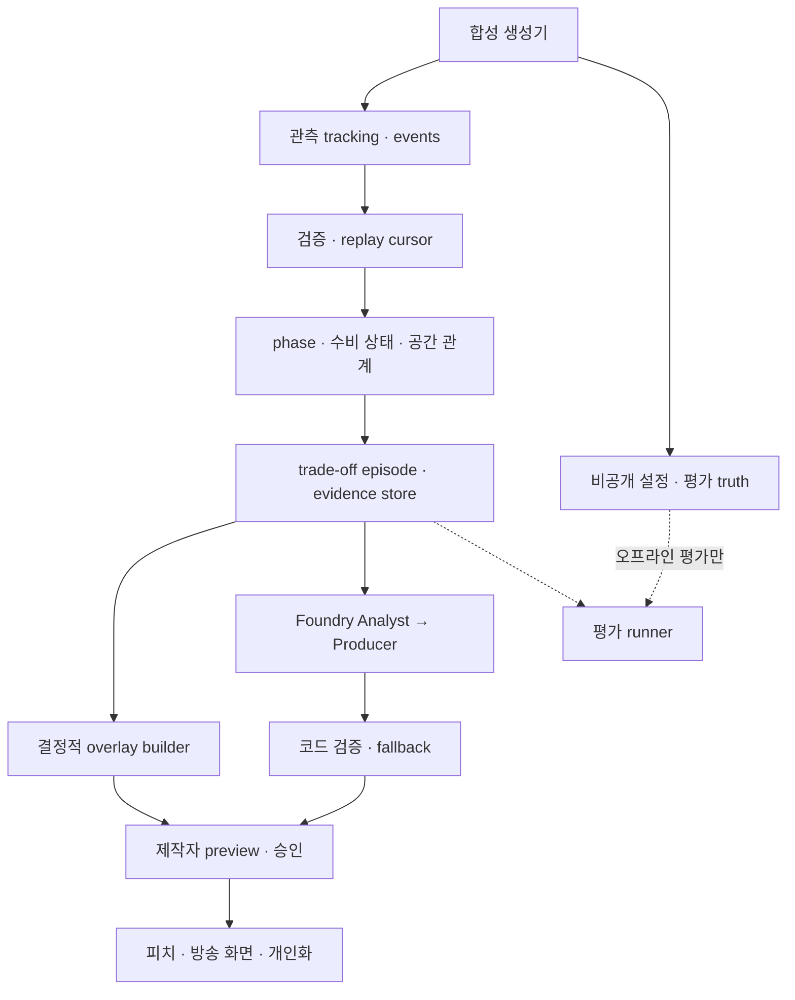

# PitchIQ — Defensive Intelligence

## Defensive Trade-off Analysis & Pitch-level Tactical Overlay Framework

**구현 명세 v2.0 · 2026-10-21 · 작성 언어: 한국어 / 코드·공개 제출 문서: 영어 / 제품 UI: EN·KO**

이 문서는 v1.0 설계(off-ball overlap 중심)를 검토해 작성한 **새 구현 기준안**이다. 최신 사용자 요구를 우선하고, 아직 논의하지 않았던 알고리즘·수치·스키마는 이 문서에서 제안하는 구현 기본값으로 명시한다. 프로젝트를 이미 구현·검증했다는 보고서가 아니다.

> **제품 정의:** PitchIQ는 합성 축구 tracking·event stream에서 수비의 압박·마킹·커버·라인 구조를 추정하고, 그 구조가 제한하는 공격 선택지와 노출하는 공간을 함께 설명하며, 상대의 대응에 따른 변화를 근거가 연결된 피치 오버레이와 방송용 해설로 제공한다.

## 1. 논의 검토와 방향 정리

### 1.1 유지·변경·추가되는 사항

| 항목 | 기존 논의/명세 | 이번 구현 기준 |
|---|---|---|
| 제품 초점 | Tactical Storytelling Copilot, 오프볼 움직임의 방송 가치 | Defensive Intelligence, 수비 선택의 trade-off와 시간적 변화 |
| 중심 질문 | 어떤 움직임이 중요한 장면을 만드는가? | 무엇을 닫고 무엇을 내주며, 상대 대응 뒤 무엇이 바뀌었는가? |
| 분석 단위 | overlap/underlap/shape-shift candidate | phase-aware defensive state와 trade-off episode |
| 핵심 지표 | 수비수 간격·패스레인 변화·관련성 | 라인 높이·라인 간격·마킹 지속성·압박 접근 방향·패스 접근성·커버·국소 수적 관계 |
| 시간적 분석 | 패턴 전후 비교 | 수비 상태 → 공격의 관측된 대응 → 수비의 재조정 → 새로운 상태 |
| 시각화 | 선수 강조·움직임 화살표·공간·캡션 | 구조·관계·차단/허용 경로·노출 공간·국소 숫자·변화를 공통 계약으로 표현 |
| LLM 역할 | 패턴 해석과 방송 해설 | 검증된 근거 중 설명할 관계를 선택하고 두 독자층에 맞게 구성 |
| 기존 오버랩 분석 | P0 주 기능 | P1 확장. 이동·마킹·레인 모듈은 재사용 |
| formation label | 4-3-3/4-4-2/3-2-5 전환 | 참고 설명. 실제 공간·관계 계산이 우선 |
| Nash/게임이론 | 초기 아이디어와 별도 Sloan 연구에 존재 | 이번 P0에서 제외. 검증하지 않은 payoff·최적 전략을 제시하지 않음 |
| 운영 흐름 | synthetic → analysis → agents → overlay → personalization | 유지. Producer preview/승인과 근거 검증도 유지 |

**이미 정해진 사용자 요구:** 수비 trade-off 중심, 피치 위의 구체적인 표현, 두 팀의 상호 대응, synthetic 데이터, 1인 개발, Microsoft 기술 활용.

**이 문서의 구현 제안:** 아래 세 시나리오의 세부 동작, 5Hz·시간창·기하 휴리스틱, 데이터 계약, API, 점수와 테스트 기준. 세 시나리오는 최근 설계 논의에서 제안된 방향을 구체화한 것이며, 과거에 모든 세부사항이 승인된 것으로 취급하지 않는다.

### 1.2 목표 사용자와 데모에서 보여줄 가치

주 사용자는 방송/스트리밍 제작자와 전술 설명 담당자다. 분석가는 근거와 수치를, 일반 팬은 같은 장면의 짧은 설명을 본다. 코치용 실전 의사결정 최적화는 장기 적용 가능성으로 남긴다.

제작자는 재생 중 제안된 장면을 선택하고, **제한된 선택지 / 노출된 공간 / 현재까지 관측된 결과**를 확인한다. 피치의 각 요소를 눌러 해당 선수·프레임·수치를 확인한 뒤 승인하면 방송용 화면에 나타난다. 설명이 유용한지 판단할 정보가 화면에 있어야 한다.

성공적인 데모에서는 “높게 압박하네”에 더해, **짧은 패스 후보 세 개가 제한되는 동안 수비 뒤 공간과 커버가 어떻게 배치되어 있는지**를 볼 수 있어야 한다. 이어 공격 미드필더가 내려오거나 긴 패스가 나왔을 때 분석이 갱신되어야 한다. 여기의 숫자는 제품 설명용 예시이며 결과가 아니다.

## 2. 범위와 우선순위

### 2.1 P0 — 제출 가능한 최소 제품

1. 매 프레임 22명과 공을 포함한 재현 가능한 합성 클립 생성/재생.
2. 세 시나리오 A/B/C와 각 시나리오의 반례. 3개 기본 클립 + 3개 비교/반례 클립, 각 24–36초를 기본 목표로 한다.
3. phase·라인·압박·마킹·패스레인·커버·국소 숫자 계산과 근거 저장.
4. 보호/제한과 노출을 함께 기록하는 trade-off episode, 한 장면 안에서 최소 한 번의 상대 대응과 재평가.
5. 동기화된 SVG 피치, 레이어 토글, 근거 선택, Before/After, episode timeline.
6. Microsoft Foundry 기반 Analyst → Producer 두 에이전트와 코드 검증, 즉시 동작하는 deterministic fallback.
7. Producer 승인 후 broadcast overlay, Fan/Analyst 및 EN/KO, 검증된 장면을 이용한 짧은 세션 recap.
8. 구조화 JSON API, Azure 데모 배포, 공개 코드와 2분 미만 데모 준비.

### 2.2 P1 / P2

| 우선순위 | 범위 |
|---|---|
| P1 | overlap/underlap 복원, 더 많은 수비 방식, 전체 전술 변화 묶음, 경량 ML 비교, player-focus, 길어진 합성 경기 |
| P2 | 실영상 추적·실제 경기 데이터 연결, 학습된 pitch control/xG, causal counterfactual, Nash 최적화, 완전한 11v11 경기 엔진, 장시간 full-match tracking, 분산 서비스 |

P0에도 경기 전체의 모든 전술을 이해하는 범용 모델은 요구하지 않는다. 3개 가족에서 관측 근거에 따라 출력이 바뀌는 동작을 완성한다. 학습 모델 추가보다 **입력 → 분석 → 오버레이 → 승인 → 개인화**의 완성을 우선한다.

## 3. 분석의 의미와 표현 규칙

### 3.1 네 가지 구분

| 구분 | 예시 | 출력 규칙 |
|---|---|---|
| 계산된 관측 | 수비 라인 깊이 45m, 중앙 구역 3v2 | 단위·프레임·계산식을 연결 |
| 휴리스틱 추론 | man-oriented 관계, 측면 유도와 일치하는 압박 | `heuristic_inference`, 지지도와 대안 설명 표시 |
| 구조적 노출 | 뒷공간, 도움 수비 도착 지연 | 노출의 존재/범위. 실점 확률로 변환하지 않음 |
| 실현된 결과 | 긴 패스 수신, 중원에서 공 탈취 | 관측된 이벤트 이후 별도 기록 |

“유도하려 했다”, “의도적으로 열어줬다”는 추적 좌표만으로 확인할 수 없다. UI의 기본 문구는 “중앙 옵션이 제한되고 왼쪽 옵션이 상대적으로 열려 있다”, “접근 궤적이 측면 유도 패턴과 일치한다”로 한다. `forced_target`은 사용하지 않고 `likely_outlet_ids`를 사용한다. 실제 패스 대상은 `realized_target_id`로 별도 기록한다.

### 3.2 금지되는 자동 결론

- 맨투맨이라고 모든 선수가 고립된 1v1에 있는 것으로 처리하지 않는다. 도움 수비와 GK 커버를 계산한다.
- 라인이 높다고 곧바로 위험한 수비라고 평가하지 않는다. 압박 강도·온사이드 러너·커버를 함께 본다.
- 깊은 라인이 항상 라인 사이를 열지는 않는다. 중원과 전방도 함께 내려왔는지 측정한다.
- 4-4-2 대 4-3-3을 자동으로 중앙 2v3으로 출력하지 않는다. 선택한 구역의 실제 선수와 패스 접근성을 계산한다.
- 선수가 마크되지 않았다고 바로 free man으로 부르지 않는다. 패스 접근성과 수신 시 압박을 함께 확인한다.
- 열린 공간과 완료된 패스, 성공한 압박과 좋은 수비 정책, 전술 변화의 시간 순서와 인과관계를 구별한다.

### 3.3 스코어의 의미

`support_score`와 `story_priority`는 [0,1] 휴리스틱이다. 확률·축구 가치·승리 가능성으로 표시하지 않는다. 수비에 대한 단일 good/bad 점수는 P0에서 만들지 않는다. 제한된 옵션과 노출을 별도 축으로 보존한다.

## 4. 시스템 아키텍처와 모듈 책임



| 모듈 | 입력 | 출력/책임 |
|---|---|---|
| `simulator` | private recipe·seed | 공개 관측 스트림과 별도 truth. 실행 시 분석 답을 제공하지 않음 |
| `replay` | 관측 스트림·세션 cursor | 해당 시점까지의 프레임·이벤트와 clock |
| `analytics/state` | trailing window | phase·line groups·pressures·relations |
| `analytics/geometry` | 위치·속도 | lane·arrival·region count·cover metrics |
| `analytics/tradeoffs` | 상태 이력 | 근거를 연결한 보호/노출 claim, episode와 변화 |
| `evidence` | 계산 결과 | 변경 불가 snapshot, metric/claim/reference 인덱스 |
| `agents` | 선택된 episode 근거 snapshot | 설명할 claim 순서·짧은 해설·개인화 |
| `validation` | agent output·같은 snapshot | 허용된 claim/ref/숫자/시간인지 검증 |
| `overlay` | state·evidence·선택한 claim | 좌표·시간·레이어가 결정된 primitives |
| `producer` | 검증된 revision·사용자 결정 | 승인/거절·방송 표시·감사 이력 |
| `frontend` | typed snapshots/updates | 재생·표시·선택. 자체 전술 판정을 하지 않음 |

**구현 스택 제안:** Python 3.11+, FastAPI, Pydantic v2, NumPy/SciPy, pytest; React/TypeScript/Vite/SVG. 한 저장소, FastAPI가 빌드된 프론트와 API를 제공하는 한 컨테이너를 기본으로 한다. 데이터는 작고 읽기 전용인 fixtures, 세션은 메모리, 데모는 한 replica·한 API worker로 시작한다.

분석은 5Hz, story trigger는 1Hz, 브라우저 보간은 requestAnimationFrame으로 분리한다. LLM은 선택된 episode에만 호출한다. LLM이 늦어도 피치와 근거는 계속 동작한다.

## 5. 좌표·시간·관측 입력 계약

### 5.1 좌표

- world pitch: 105m × 68m. `(0,0)`은 왼쪽 아래, x는 오른쪽, y는 위쪽. 속도는 별도 `vx_mps/vy_mps` 필드다.
- 소유 팀 A의 공격 방향 `a ∈ {+1,-1}`에 대해 `u=x, v=y`(a=+1), `u=105-x, v=68-y`(a=-1). 속도도 a=-1이면 두 성분을 반전한다. 이 회전은 공격 방향 기준 좌우를 유지한다.
- A의 상대 D가 지키는 골은 정규화 좌표 u=105다. D 선수의 own-goal depth는 `d=105-u`. d가 크면 D 자신의 골에서 멀리 올라온 상태다.
- world 원본을 저장하고, 계산에서만 정규화한다. SVG는 world 좌표로 환산한 후 `svg_y=68-y`로 표시한다. 뷰 회전도 모든 레이어에 같은 변환을 적용한다.
- formation은 GK를 제외한 10명의 조직 설명이다. 압박/패스/커버 계산에서는 GK를 필요한 경우 포함한다.
- P0의 각 MatchMeta/clip은 한 period만 다룬다. 2nd-half 클립을 추가하면 해당 period의 공격 방향을 별도 metadata로 제공하고 frame의 period와 일치시킨다. 전후반 경계를 넘는 clip은 P0에서 제외한다.

### 5.2 시간과 causality fence

- `match_time_s`: 공통 경기 시간. 프레임 5Hz, dt=0.2s. `frame_index`는 clip 내 0부터 증가한다. `(clip_id, frame_index)`가 고유 프레임 키다.
- `event_time_s`: 사건이 일어난 시점. `available_at_s`: 그 사건이 입력에 관측된 시점. 두 값 모두 현재 cursor 이하일 때만 분석에 전달한다.
- pass release 이벤트에는 미래 수신자 성공 여부를 넣지 않는다. receive/interception은 실제 발생 시 별도 이벤트로 보낸다.
- 프레임 t 분석은 `[t-W,t]`만 본다. 중앙 이동평균·미래 프레임·클립 전체 정규화·완료된 패스의 미래 결과 사용을 금지한다.
- 렌더링도 현재 cursor까지 받은 프레임을 대상으로 한다. 부드러운 보간을 위해 0.2s 시각 버퍼를 둘 수 있으나 분석 cursor와 display cursor를 명시하고 미래 입력을 분석에 쓰지 않는다.

### 5.3 공개 입력과 비공개 truth

공개 입력은 선수/팀 ID, GK 여부, 위치·속도, 공 위치, 소유권과 관측 이벤트다. GK 외의 nominal role/formation은 선택적 roster 참고 정보이며 P0 detector feature에서는 제외한다. 클립 ID는 `clip_001`처럼 전술 답을 포함하지 않는 값으로 생성한다.

비공개 파일에는 recipe, seed, 의도, true phase, 행동 제어 파라미터, 기대 변화를 둔다. `analytics`는 `simulator/private_truth`를 import하지 않고, 서빙 이미지에 private truth를 포함하지 않는다. 공개 catalog에도 `high_press`, `expected_free_man` 같은 정답을 노출하지 않는다. 평가 runner만 관측과 truth를 결합한다.

기본 불변식: 선수 22명·팀당 11명·GK 1명, 유일 ID, 유한 수치·범위, 단조 시간, 유효 참조, 소유자와 소유 팀 일치. substitutions는 P0에서 제외한다. 이동 속도 9m/s·가속 5m/s²·공 35m/s는 개발용 cap이며 실측 규칙이 아니다. 공이 발을 떠난 구간은 owner=null이다.

## 6. Synthetic 시나리오와 생성 방식

### 6.1 세 가지 가족

| 가족 | 출발 구조 | 관측할 제한/보호 | 검증할 노출 | 공격 대응과 수비 재조정 |
|---|---|---|---|---|
| A: 높은 man-oriented press + 높은 back line | 짧은 빌드업 상대에게 지속적 근접·추종 | 짧은 패스 후보의 접근성 감소 | 라인 뒤 공간, 커버 없는 1v1 후보 | 온사이드 러너의 전진/긴 패스 → D의 회복 또는 커버 이동 |
| B: 높은 전방 압박 + 더 깊은 back line | 전방은 유지하고 back line을 낮춘 비교 | back line 뒤의 기하학적 깊이 감소 | 전방–후방/중원–후방 분리, 라인 사이 수신 및 세컨드볼 지원 지연 | A의 미드필더가 라인 사이로 이동 → D의 중원 후퇴/전방 압박 중단 |
| C: 방향성·lane-oriented press | 중앙 경로를 제한하며 측면 옵션을 허용 | 중앙 후보의 geometric screen | 측면 출구·반대편 접근성, 중앙 overload 가능성 | A의 중앙 선수 드롭/측면 순환 → D의 CM 전진 또는 block shift |

세 가족 모두 효과를 사전에 보장하지 않는다. 지표가 조건을 만족하지 않으면 해당 claim을 만들지 않는다. B의 세컨드볼은 공중볼/낙하지점이 관측되는 경우에만 도착 시간 근거를 붙이고, 그 전에는 line separation만 설명한다.

### 6.2 반드시 포함할 비교와 반례

| 가족 | 최소 반례 | 확인할 동작 |
|---|---|---|
| A | 같은 높은 라인이지만 여분 CB/GK가 커버 | behind-space는 남아도 isolated-1v1 claim은 억제 |
| B | 수비·중원·전방이 함께 내려와 compact 유지 | deep-line만 보고 between-line exposure를 생성하지 않음 |
| C | 명목상 4-4-2 대 4-3-3이지만 winger가 안쪽으로 지원하거나 패스레인이 막힘 | 3v2 자동 출력 금지. free-man과 숫자 우위를 별도로 처리 |

추가 반례: 측면 유도처럼 보이지만 1프레임만 근접, 마크 교환, 중앙 숫자는 우위지만 offside/패스 접근 불가, 소유권 전환, 인접한 두 선수만 따라 움직이는 우연, 높은 압박이 실제로 공 탈취에 성공하는 경우. 마지막 경우에도 이전 노출 근거를 사후 삭제하지 않는다.

### 6.3 생성 엔진

고정된 장면을 답 라벨과 함께 재생하지 않는다. 역할별 목표 위치, 공·상대 위치에 대한 반응, 지연, 공간 제약을 이용한 간단한 behavior generator를 만든다. `desired_velocity → acceleration clamp → speed clamp → integration` 순서로 갱신하고 경계·최소 간격을 확인한다. smoothing 뒤에도 속도/가속 한도를 검사한다.

공격의 드롭·전진, 수비의 추종·유지·커버·라인 후퇴를 반응 정책으로 설정한다. private 계획이 움직임을 생성할 수는 있지만, 공개 분석은 움직임만 읽는다. pass release와 receive 사이 공 위치가 연속이어야 하고 소유권과 이벤트가 일치해야 한다. 공중볼은 선택적인 `z_m` 궤적으로만 단순화하며 별도 완전한 물리 엔진은 만들지 않는다.

같은 seed는 같은 fixture checksum을 생성한다. 초기 위치·타이밍·반응 지연·마킹 거리·라인 높이·패스 선택·성공/실패를 변형한다. P0 개발용 6클립과 별도로, family별 최소 10개 holdout 및 반례를 목표로 한다. 이 숫자는 개발 목표이며 검증 결과가 아니다. holdout은 seed뿐 아니라 반응/간격 파라미터 조합도 분리한다.

초기 파일 구성: `data/public/<opaque_clip_id>/{manifest.json,tracking.jsonl,events.jsonl}`와 별도의 `evaluation/private_truth/`. public manifest는 팀·pitch·샘플 간격·길이·로스터·checksum만 담는다. 긴 가상 90분 경기나 학습 데이터 대량 생성은 이번 P0의 선행 조건이 아니다.

## 7. Tactical State Estimation

### 7.1 Phase를 먼저 판정

`possession_phase = buildup | progression | transition | unknown`과 `ball_state = controlled | in_flight | loose | dead`를 독립 필드로 둔다. `active_press`는 별도 신호다.

소유 팀이 바뀐 뒤 기본 2초는 transition, controlled 상태와 팀 조직이 안정되면 buildup/progression을 위치로 구분한다. in_flight 구간은 직전 episode를 유지할 수 있으나 새로운 settled-shape claim은 만들지 않는다. owner/팀/위치가 모순되면 unknown이다. transition 판정에 generator의 private phase를 쓰지 않는다.

### 7.2 Line·shape

최근 3초 outfield 위치를 own-goal depth로 정규화하고 시간 중앙값으로 smoothing한다. d 순으로 정렬해 인접한 line partition 후보를 만든다. 최소 2명인 3개 line의 within-line spread와 시간에 따른 membership 변화를 비용으로 비교한다. P0에서 `(4,4,2)`, `(4,3,3)`, `(3,2,5)` 등을 후보로 둘 수 있으나, 낮은 비용이라는 이유만으로 항상 하나를 강제하지 않는다.

후보 최대 line spread·시간적 안정성·차선 후보와의 비용 차이 기준을 설정한다. 3초 이상 지지되지 않거나 line membership이 불안정하면 `ambiguous/transition/unclassified`로 남긴다. `shape_label`이 불명확해도 식별 가능한 back line과 중앙 숫자는 독립 출력할 수 있다. 의미 없는 연속 1D clustering 결과를 전술 확정으로 표현하지 않는다.

- `back_line_depth_m = median(d of inferred back-line players)`.
- `space_behind_depth_m = back_line_depth_m`는 정규화 좌표의 골라인까지 깊이이며 빈 공간 전체/활용 가능 면적과 다르다.
- `mid_back_gap_m = median(d_mid)-median(d_back)`.
- `front_back_span_m = median(d_front)-median(d_back)`.
- 각 metric에 contributing player IDs, 측정 시간창, membership 지지도를 저장한다.

### 7.3 Pressure와 접근 방향

ball owner와 D 선수 거리, 거리 감소율, 상대 속도를 1초 trailing window로 계산한다. 기본 candidate gate는 거리 ≤6m이고 상대 접근 속도 ≥1m/s가 0.6초 지속되는 경우다. 2m 이내 지속 근접은 낮은 접근 속도라도 pressure로 유지할 수 있다. 제동/접촉 처리 한계를 기록한다.

`primary_presser_id`, `distance_to_carrier_m`, `closing_speed_mps`, `approach_vector`, `support_score`를 출력한다. 접근 화살표는 **관측된 속도/궤적**이다. 이것을 몸 방향으로 표시하지 않는다.

방향성 유도는 2초 동안 중앙/좌·우 외곽의 패스 후보 접근성을 비교한다. 한쪽 외곽 출구가 남고 중앙 옵션이 제한되며 presser가 해당 위치 관계를 지속하면 `funnel_toward_left/right` 추론을 만든다. 단순히 선수 이동 방향을 반대로 그려 유도 방향을 만들지 않는다. 몸 방향 입력이 없으므로 cover shadow는 `approx_screen`으로만 표시한다.

### 7.4 Man-oriented 관계

최근 3초 D–A 각 pair의 평균 거리·상대 속도·거리 안정성을 계산한다. 후보 pair는 평균 거리 ≤5m와 최소 지속 시간 2초를 요구한다. 비용 예시는 `distance_m + 0.5s * relative_speed_mps + 2m * assignment_switch`다. 실제 계수는 config로 분리한다.

SciPy 선형 assignment에 unmatched dummy를 추가한다. 모든 선수를 억지로 연결하지 않는다. 움직임이 거의 없는 pair는 근접 관계만 인정하고 추종 근거는 낮춘다. 마크 교환은 새 edge와 종료 시간으로 보존한다. `man_oriented`는 active ball zone(공 반경 30m)의 복수 pair가 지속되고 follow consistency가 충분한 경우에만 사용한다. primary presser와 carrier 관계는 별도 pressure edge로 남긴다.

P0 기본 gate: active zone에 지지된 marking edge ≥4개, 관측 가능한 zone 상대의 ≥60%가 2초 이상 지속. 이 gate는 범용 전술 분류의 정답이 아니라 합성 데모용 설정이다.

## 8. 패스·공간·수적 관계 계산

### 8.1 Short passing-lane 후보

controlled carrier에서 5–25m 거리의 teammate 후보를 만든다. 후보별 직선 segment와 receiver 주변 압박을 계산한다. GK도 후보가 될 수 있다. offside 기하 판정이 가능한 경우 eligibility를 기록하고, 부적격 후보는 열린 옵션 수에 포함하지 않는다.

빠른 geometry baseline: defender와 pass segment 사이 거리, projection 위치를 계산한다. 이후 2m 간격의 내부 점 q에서 `ball_time(q)=distance(carrier,q)/14m/s`, `def_time(q)=0.2s+distance(defender,q)/7m/s`를 비교한다. `min(def_time-ball_time) ≤ 0.1s`이면 screened, ≥0.4s이면 open, 그 사이는 uncertain으로 한다. endpoint의 수신 경쟁도 따로 확인한다. 상대가 release 직전 공 근처에 있다는 사실은 별도 `release_pressure`로 기록한다.

이는 고정 반응/속도를 가정한 **ground-pass 접근성 휴리스틱**이다. 실제 패스 성공 확률이나 공중볼의 차단 가능성이 아니다. segment 시작/끝 1m를 내부 sampling에서 제외하고 receiver competition을 따로 계산해 중복 판정을 피한다. threshold 경계와 짧은 pass는 uncertain 처리한다.

`short_options_screened` claim에는 전체 candidate 수와 screened 수를 함께 넣는다. 다른 위치/다른 후보 집합의 전후 개수는 그대로 효과 비교하지 않는다. 같은 receiver 집합에 대한 paired change와 새 receiver의 등장 여부를 별도로 보존한다.

### 8.2 Approximate offside eligibility

관측 snapshot에서 A 공격 좌표 u를 기준으로 D의 **GK 포함** 두 번째로 높은 u와 공 u의 max를 line으로 쓴다. 공격수가 자기 진영에 있거나 이 line보다 뒤/같은 위치면 기하상 onside 후보로 둔다. 모호한 위치 오차는 unknown이다. 실제 판정 시스템을 표방하지 않는다.

실제 release 이벤트가 생기면 그 순간의 frame으로 재평가한다. 현재 offside인 선수를 현재 열린 패스 옵션으로 세지 않는다. 온사이드 러너가 패스 후 뒷공간으로 들어가는 경로는 허용한다. 현재 좌표만으로 미래 패스 순간의 eligibility를 단정하지 않는다.

### 8.3 Cover와 isolated 1v1

matched defender 외의 D 선수들이 공격수의 짧은 예상 진행점(현재 속도 1초 외삽, pitch clamp)에 도달하는 시간을 같은 휴리스틱으로 계산한다. 도움 수비의 골 쪽 위치 관계도 확인한다. GK는 별도 cover 후보로 포함한다. `nearest_cover_id`, `cover_arrival_s`, `attacker_arrival_s`, `cover_margin_s`를 저장한다.

pair proximity만 있고 커버 평가가 불가능하면 `marked_pair`만 표시한다. `isolated_1v1`은 지지된 marking pair, 공격 관련성, 현재 onside, secondary cover 지연(예: 0.5초 초과)이 모두 충족될 때만 추론한다. GK가 먼저 도달할 수 있으면 고립 claim을 억제하거나 제한적으로 설명한다.

### 8.4 Regions와 국소 숫자

기본 central analysis region은 A 공격 좌표 `[u_ball+5,u_ball+25] × [20,48]`, pitch에 clip한다. 구역이 너무 작거나 dead ball이면 계산하지 않는다. 같은 시점·같은 polygon 안의 양 팀 outfield IDs를 세고 GK는 제외한다. 이 구역은 화면에 항상 표시한다.

`central_count_A`, `central_count_D`, `central_delta`와 선수 IDs를 저장한다. 숫자 우위는 국소 count이며 전술 효과와 다르다. 후보가 마킹 약함 + 유효한 lane + receiver arrival 우세를 만족할 때만 `accessible_free_receiver`를 출력한다. 3v2지만 lane이 막힌 경우 숫자는 표시하고 free-man 강조는 하지 않는다.

수신 경쟁의 시작 구현은 receiver 현재 위치 q에서 `min_D(T_D(q)) - max(T_ball(q),T_receiver(q)) ≥0.3s`를 우세 gate로 쓴다. 낮은 marking support는 <0.4, 최근 1초 nearest defender 거리 ≥4m로 시작한다. 각 항목은 독립 metric이며 모두 지지되지 않으면 free receiver 대신 candidate로만 남긴다. stationary attacker를 커버 외삽으로 고립 러너로 만들지 않으며, 전진 속도 근거가 없으면 `isolated_1v1`/behind-run 해석을 보류한다.

라인 사이 region은 식별된 back/mid line 사이 polygon으로, behind region은 back line의 골 쪽 polygon으로 만든다. 단순 polygon 전체를 “통제하지 못하는 공간”으로 표시하지 않는다. 실제 공격 후보·lane·커버가 관련된 부분을 `exposure_zone`으로 좁힌다. weak-side는 공 y와 반대 외곽 구역으로 정의하고 접근 가능한 switch 후보가 있을 때만 강조한다.

### 8.5 세컨드볼

공중볼/duel 직후 관측된 공 위치나 공개 ball state에서 추정한 짧은 낙하지점 주위 12m 구역에서 각 팀 도착시간과 support count를 계산한다. private 예정 착지점은 사용하지 않는다. 낙하지점이 불명확하면 second-ball metric=null이고 라인 간격만 설명한다. 이 계산은 B의 부가 근거이며, P0의 핵심 완성 조건은 B의 line separation과 라인 사이 수신을 실제로 갱신하는 것이다.

## 9. Defensive Trade-off Engine과 시간적 대응

### 9.1 Claim 생성 조건

아래 수치는 구현 시작점이다. `analytics_config.yaml`에 모으고 변경 이력을 기록한다. 실세계 학습/검증된 축구 기준으로 제시하지 않는다.

| claim code | 최소 근거 | 억제/abstain 조건 |
|---|---|---|
| `short_options_screened` | eligible short options ≥3, screened ≥2, 1초 지속 | receiver 후보 집합/owner가 불명확 |
| `central_routes_screened` | 중앙 eligible 후보 ≥2 중 screened ≥2, 구역과 presser 근거 | 후보가 원래 없음, 1회 근접뿐 |
| `behind_space_exposed` | back depth ≥40m, 온사이드 전진 후보, 늦은 secondary cover | 공간 깊이만 큼, 러너가 offside/무관 |
| `behind_depth_reduced` | 같은 팀 전후 back depth가 ≥8m 감소 | 비교 baseline 없음, back membership 변경으로 불명확 |
| `press_block_disconnected` | active press, front-back span ≥35m 또는 mid-back gap ≥20m, 관련 공격 후보 | 전후 조직이 식별 불가, 전환 중 |
| `between_lines_receiver` | 실제 identified line 사이 A 선수가 있고 lane/수신 경쟁이 지지됨 | 영역만 비어 있음, lane screened |
| `isolated_1v1` | 지지된 pair + onside + 관련 공격 + cover margin ≥0.5s | secondary/GK cover가 제시간 도착 가능 |
| `wide_outlet_available` | central screening과 같은 창에서 외곽 eligible lane open | wide receiver가 마킹 약해도 pass 접근 불가 |
| `weak_side_accessible` | 공 반대편 후보와 유효한 switch 접근 근거 | P0 ground-pass model로 검증 불가한 장거리/공중 switch |
| `local_central_overload` | 고정 region 내 A count-D count ≥1, 1초 지속 | formation명만 근거, region 경계 jitter |
| `accessible_free_receiver` | 낮은 marking support + eligible open lane + 수신 경쟁 우세 | 숫자 우위뿐, receiver offside |
| `second_ball_support_gap` | 관측된/추정 가능한 낙하지점과 team arrival 차이 | 예정 낙하지점만 있음, 공 궤적 불명확 |

한 claim에는 근거 metric IDs, 선수 IDs, observation refs, 시간창을 필수로 넣는다. 값이 없으면 `null/status=unavailable`이며 0으로 대체하지 않는다. 추론은 지지도 gate를 통과해야 하고, 자료가 부족한 상태는 `insufficient_evidence`다.

### 9.2 Trade-off 묶음

- A형: `short_options_screened` + `behind_space_exposed`/`isolated_1v1`.
- B형: `behind_depth_reduced` 또는 깊이 자체의 설명 + `press_block_disconnected`/`between_lines_receiver`.
- C형: `central_routes_screened` + `wide_outlet_available`/`accessible_free_receiver`.
- 보호 쪽 근거만 있으면 partial analysis로 보여주고 완성된 trade-off로 포장하지 않는다. 노출이 없다는 결론도 근거가 필요하다.

B에서 전후 비교 없이 “뒷공간을 줄였다”는 동사를 쓰지 않는다. 현재 깊이를 설명하거나, 같은 episode의 전후 값/명시적 합성 비교에서 감소를 계산한 뒤 변화 문장을 쓴다. 별도 시뮬레이션 클립 비교는 `synthetic_comparison`으로 표기한다. 관측된 실제 경기의 causal counterfactual로 제시하지 않는다.

### 9.3 Episode 상태와 변화

episode의 기준 키는 defending team·active phase·중심 region·claim family다. `candidate → active → cooling → closed`를 사용한다. 신규 조건은 기본 1초 지속 후 active, 조건이 1.5초 사라지면 cooling, 3초 사라지거나 소유 팀이 바뀌면 closed다. 작은 jitter는 같은 episode로 merge한다.

변화는 다음 구조로 남긴다.

1. **Initial state:** 압박·마킹·레인·수적 관계 snapshot.
2. **Attacking response observed:** 예를 들어 중앙 선수가 이전 3초 대비 5m 이상 내려오고 region/lane 관계가 변함. 명목상 AM/DM 라벨에 의존하지 않는다.
3. **Defensive adjustment observed:** CM/전방/line의 위치·assignment가 지속적으로 바뀜.
4. **Updated state:** free receiver, 커버, lane 또는 line-gap 근거가 다시 계산됨.

각 전환의 `relation`은 `observed_next` 또는 `consistent_with_response`다. 코치의 의도와 인과는 확정하지 않는다. 최소 P0 세 가족 각각에 한 번의 관측된 관계 변화가 있어야 하며, C는 공격 드롭 뒤 수비 지원으로 free receiver 강조가 사라지는 장면을 우선 구현한다.

### 9.4 결과·스토리 선별

`outcome`은 `not_yet_observed | exploited_in_synthetic_play | not_exploited_in_window | inconclusive`다. 결과 이벤트는 episode evidence cutoff 이후에 도착하면 **새 revision**에 추가한다. 예를 들어 긴 패스가 완료되어도 이전에 “성공할 것”이라고 분석한 것으로 바꾸지 않는다.

관측 결과는 기본 episode 활성화 후 6초의 창에서만 연결하고, 종료 전에 이벤트가 없으면 not_yet_observed다. 6초가 지난 뒤 추적이 끊기면 inconclusive, 추적이 완전하고 이용 이벤트가 없으면 not_exploited_in_window다. 위험 노출이 있었다는 과거 분석은 결과 때문에 삭제하지 않는다.

story priority의 시작값: `0.35*support + 0.25*change_magnitude + 0.25*ball_relevance + 0.15*novelty`. 각 성분과 정규화 범위를 기록한다. 최소 support 0.65, priority 0.6을 제안 gate로 시작한다. novelty는 최근 15초 동일 팀/region/claim 중복을 줄인다. outcome의 성공 여부를 과거 priority 계산에 소급하지 않는다. 숫자는 UI의 `evidence strength/priority`이며 퍼센트 확률로 쓰지 않는다.

## 10. Pitch-level Tactical Overlay Framework

### 10.1 원칙과 레이어 계약

오버레이는 해설과 별개로 같은 evidence에서 생성되는 구조화 출력이다. 하나의 claim을 선택하면 관련 선수·관계·공간·수치만 함께 나타나야 한다. LLM은 유효한 claim/layer ID를 선택할 수 있지만 좌표·선수·metric 값을 생성하지 않는다.

| layer | 의미와 primitive | 근거 |
|---|---|---|
| `structure` | back/mid/front line polyline, 라인 높이 label | inferred membership·depth·gap |
| `marking` | D–A connection, 지지도에 따른 실선/점선 | sustained pair evidence |
| `pressure` | presser 이동/접근 arrow, carrier ring | 관측 velocity·distance·closing |
| `screened_lanes` | 차단 후보 segment와 근사 screen polygon | lane geometry·arrival margin |
| `outlets` | 허용 후보 arrow, target ring | eligible lane·receiver 경쟁 |
| `exposure` | behind/between-line/weak-side polygon | 관련 claim과 cover/receiver 근거 |
| `cover` | secondary/GK cover connection과 시간 label | arrival model·goal-side 관계 |
| `numbers` | 분석 region polygon, 실제 player rings, `3 v 2` label | same-region player IDs/counts |
| `changes` | 이전 상태 ghost/이동 polyline·assignment 변화 | 이전/현재 snapshot pair |
| `caption` | 선택 claim의 Fan/Analyst EN/KO 설명 | 검증된 sentence plan |

`structure/marking/pressure`는 관측/추정 관계, `outlets/exposure`는 공격의 가능성, `realized play`는 관측된 공 궤적을 표현한다. 색 외에 실선/점선/해칭/아이콘·범례를 함께 쓴다. 허용된 경로와 실제 패스를 같은 선으로 표시하지 않는다. presumed funnel은 점선, 관측 압박 접근은 실선이다.

### 10.2 View preset과 혼잡 제어

- Fan: 관련 presser·짧은 설명·주요 노출 하나, 기본 ≤6 표시 단위와 label ≤2. 표시 단위는 같은 뜻을 함께 전하는 도형 묶음이다(막힌 패스 길들, presser 화살표와 carrier 링, 노출 공간과 runner 링, 열린 outlet과 target, 늦은 cover와 연결선). 완전한 trade-off는 제한·노출 양쪽 단위를 최소 1개씩 남긴다. (2026-10-24 개정, 사용자 승인: 도형 6개로 세면 방송 화면에서 막힌 패스 길이나 노출 쪽이 통째로 빠졌다.)
- Analyst: 선택한 episode의 구조·관계·구역·근거, 기본 ≤20 elements와 label ≤5.
- Producer inspector: 모든 toggle과 JSON·evidence. broadcast preview와 구분된 표식을 둔다.

지표를 전부 켜는 화면을 기본값으로 만들지 않는다. `focus_claim_id`가 표시 요소를 제한한다. label 충돌 시 낮은 priority label을 숨기고 inspector에 남긴다. legend는 현재 켜진 의미만 보여준다.

### 10.3 Snapshot·anchor·시간

`OverlaySnapshot`은 `frame_ref`, `match_time_s`, `valid_until_s`, `analysis_epoch`, evidence revision을 가진다. primitive는 player anchor 또는 world point를 참조한다. 현재 프레임에서 resolve한 위치와 같은 시점의 metric만 사용한다. 과거의 3v2 숫자를 현재 선수 위치 위에 붙이지 않는다.

같은 episode가 유지돼도 geometry는 5Hz로 갱신하고, 집계 값에는 `[window_start,window_end]`를 표시한다. Before/After는 두 frozen snapshot을 각각 해당 프레임 위에 그린다. 미래 위치를 ghost로 사용하지 않는다. live overlay TTL 기본 0.6s, 갱신이 멎으면 숨기고 stale 표시한다. 과거 장면 preview는 live TTL과 별도다.

**방송의 P0 주 경로는 live suggestion → 승인 → 해당 장면의 retrospective replay다.** live inspector는 현재 분석을 계속 갱신한다. 승인된 문장과 기하는 승인 packet의 보관된 시간창에서만 replay한다. 새 프레임의 metric/claim이 달라지면 새 suggested revision으로 만들며 기존 승인으로 덮지 않는다. cloud 지연 후 과거 근거를 현재 피치에 붙이는 방식으로 live 방송을 흉내 내지 않는다. replay에는 `REPLAY · analyzed through t`를 표시하고, 해설이 당시 실시간으로 도착했던 것처럼 backdate하지 않는다.

## 11. 공통 타입과 데이터 계약

이 절은 구현 시 Python Pydantic와 TypeScript 타입으로 옮길 계약이다. `ID`는 opaque string, 좌표/시간은 유한 수치이며 모든 `*_ids` 참조를 검사한다. `?`는 생략 가능, `null`은 값 불명/미관측을 의미한다. `schema_version`은 `2.0`이다.

```typescript
type ID = string;
type XY = { x_m: number; y_m: number };
type Velocity = { vx_mps: number; vy_mps: number };
type FrameRef = { clip_id: ID; frame_index: number };
type Window = { start_s: number; end_s: number };
type EvidenceStatus = "ok" | "uncertain" | "unavailable";
type SourceMode = "foundry_live" | "foundry_cached" | "deterministic_fallback";
type Epistemic = "computed_observation" | "heuristic_inference" | "realized_event";

interface MatchMeta {
  schema_version: "2.0";
  match_id: ID;
  period: 1 | 2;
  pitch: { length_m: 105; width_m: 68 };
  tracking_hz: 5;
  teams: Array<{ team_id: ID; display_name: string; attack_direction: 1 | -1 }>;
  roster: Array<{ player_id: ID; team_id: ID; jersey: number; is_goalkeeper: boolean }>;
  clips: Array<{ clip_id: ID; start_s: number; end_s: number; checksum: string }>;
}

interface ObservationFrame {
  schema_version: "2.0";
  match_id: ID;
  frame_ref: FrameRef;
  period: 1 | 2;
  match_time_s: number;
  players: Array<{
    player_id: ID; team_id: ID; is_goalkeeper: boolean;
    position: XY; velocity: Velocity;
  }>;
  ball: { position: XY; z_m: number; owner_id: ID | null };
  possession_team_id: ID | null;
  ball_state: "controlled" | "in_flight" | "loose" | "dead";
}

interface MatchEvent {
  event_id: ID;
  match_id: ID;
  clip_id: ID;
  event_time_s: number;
  available_at_s: number;
  kind: "pass_release" | "pass_receive" | "interception" | "carry"
      | "duel" | "turnover" | "shot" | "goal" | "restart";
  actor_id: ID | null;
  target_id: ID | null; // P0 release: null; receive: observed receiver only
  related_event_id: ID | null;
  position: XY | null;
}

interface LineGroup {
  group: "back" | "mid" | "front";
  player_ids: ID[];
  own_goal_depth_m: number;
  spread_m: number;
  support_score: number;
}
interface MarkingRelation {
  relation_id: ID;
  defender_id: ID;
  attacker_id: ID;
  since_s: number;
  mean_distance_m: number;
  follow_support_score: number;
  status: EvidenceStatus;
}
interface LaneRelation {
  relation_id: ID;
  carrier_id: ID;
  receiver_id: ID;
  start: XY;
  end: XY;
  eligibility: "onside_geometry" | "offside_geometry" | "unknown";
  availability: "open" | "screened" | "uncertain";
  min_arrival_margin_s: number | null;
  screening_player_ids: ID[];
}
interface PressureRelation {
  relation_id: ID;
  presser_id: ID;
  carrier_id: ID;
  distance_m: number;
  closing_speed_mps: number;
  approach_vector: Velocity;
  funnel: "left" | "right" | "none" | "uncertain";
  likely_outlet_ids: ID[];
  support_score: number;
}
interface CoverRelation {
  relation_id: ID;
  attacker_id: ID;
  primary_defender_id: ID | null;
  cover_player_id: ID | null;
  target: XY;
  attacker_arrival_s: number | null;
  cover_arrival_s: number | null;
  cover_margin_s: number | null; // cover arrival - attacker arrival
  status: EvidenceStatus;
}
interface LocalRegion {
  region_id: ID;
  polygon: XY[];
  attacking_player_ids: ID[];
  defending_player_ids: ID[];
  accessible_receiver_ids: ID[];
}
interface TacticalState {
  state_id: ID;
  analyzed_until_s: number;
  frame_ref: FrameRef;
  window: Window;
  attacking_team_id: ID | null;
  defending_team_id: ID | null;
  possession_phase: "buildup" | "progression" | "transition" | "unknown";
  active_press: boolean;
  shape_label: "approx_442" | "approx_433" | "approx_325"
             | "ambiguous" | "transition" | "unclassified";
  line_groups: LineGroup[];
  markings: MarkingRelation[];
  pressures: PressureRelation[];
  lanes: LaneRelation[];
  covers: CoverRelation[];
  regions: LocalRegion[];
  quality_flags: string[];
}

type ClaimCode = "short_options_screened" | "central_routes_screened"
  | "behind_space_exposed" | "behind_depth_reduced" | "press_block_disconnected"
  | "between_lines_receiver" | "isolated_1v1" | "wide_outlet_available"
  | "weak_side_accessible" | "local_central_overload"
  | "accessible_free_receiver" | "second_ball_support_gap";

interface EvidenceMetric {
  metric_id: ID;
  key: string; // allowlisted key from the versioned metric registry
  value: number | null;
  unit: "m" | "s" | "mps" | "count" | "ratio" | "score";
  status: EvidenceStatus;
  window: Window;
  player_ids: ID[];
  frame_refs: FrameRef[];
  event_ids: ID[];
  method_version: string;
}
interface TacticalClaim {
  claim_id: ID;
  code: ClaimCode;
  epistemic: Epistemic;
  dimension: "restricted" | "exposed" | "context";
  metric_ids: ID[];
  relation_ids: ID[];
  player_ids: ID[];
  support_score: number;
  window: Window;
}
interface TacticalChange {
  change_id: ID;
  before_state_id: ID;
  after_state_id: ID;
  actor_team_id: ID;
  actor_player_ids: ID[];
  code: "attacker_drop" | "defender_step" | "line_retreat" | "block_shift"
      | "mark_switch" | "lane_change" | "count_change";
  relation: "observed_next" | "consistent_with_response";
  metric_ids: ID[];
  observed_at_s: number;
}
interface TradeoffEpisode {
  episode_id: ID;
  revision: number;
  match_id: ID;
  clip_id: ID;
  lifecycle: "candidate" | "active" | "cooling" | "closed";
  analysis_status: "complete_tradeoff" | "partial" | "insufficient_evidence";
  defending_team_id: ID;
  analyzed_until_s: number;
  detected_at_s: number;
  window: Window;
  state_ids: ID[];
  restricted_claim_ids: ID[];
  exposed_claim_ids: ID[];
  context_claim_ids: ID[];
  change_ids: ID[];
  story_priority: number;
  outcome: {
    status: "not_yet_observed" | "exploited_in_synthetic_play"
          | "not_exploited_in_window" | "inconclusive";
    observed_until_s: number;
    event_ids: ID[];
    realized_target_id: ID | null;
  };
}
interface EvidencePacket {
  schema_version: "2.0";
  evidence_hash: string;
  episode: TradeoffEpisode;
  states: TacticalState[];
  metrics: EvidenceMetric[];
  claims: TacticalClaim[];
  changes: TacticalChange[];
  events: MatchEvent[];
  forbidden_inferences: string[];
}

type Layer = "structure" | "marking" | "pressure" | "screened_lanes"
  | "outlets" | "exposure" | "cover" | "numbers" | "changes" | "caption";
type Anchor = { kind: "player"; player_id: ID } | { kind: "world"; point: XY };
type Geometry =
  | { type: "ring"; center: Anchor; radius_m: number }
  | { type: "connection"; from: Anchor; to: Anchor }
  | { type: "arrow"; from: Anchor; to: Anchor; meaning: "observed" | "inferred" }
  | { type: "polygon"; points: XY[] }
  | { type: "polyline"; points: XY[] }
  | { type: "label"; at: Anchor; template_key: string; metric_ids: ID[] };
interface OverlayElement {
  element_id: ID;
  layer: Layer;
  claim_ids: ID[];
  metric_ids: ID[];
  relation_ids: ID[];
  geometry: Geometry;
  style_token: string; // allowlisted registry; no raw CSS/SVG/HTML
}
interface OverlaySnapshot {
  schema_version: "2.0";
  overlay_id: ID;
  replay_id: ID;
  analysis_epoch: number;
  episode_id: ID;
  episode_revision: number;
  evidence_hash: string;
  frame_ref: FrameRef;
  match_time_s: number;
  valid_until_s: number;
  display_mode: "live" | "retrospective_replay";
  surface: "inspector_preview" | "broadcast";
  audience: "fan" | "analyst";
  language: "en" | "ko";
  elements: OverlayElement[];
}

interface AnalystPlan {
  episode_id: ID;
  evidence_hash: string;
  focus_claim_ids: ID[];
  restricted_claim_ids: ID[];
  exposed_claim_ids: ID[];
  ordered_change_ids: ID[];
  omitted_claim_ids: ID[];
  caveat_codes: string[];
}
interface SentencePlan {
  template_key: string;
  claim_id: ID | null;
  change_id: ID | null;
  metric_ids: ID[];
  event_ids: ID[];
}
interface ProducerPlan {
  episode_id: ID;
  evidence_hash: string;
  variants: Array<{
    audience: "fan" | "analyst";
    language: "en" | "ko";
    sentences: SentencePlan[];
    focus_layers: Layer[];
  }>;
}
interface InsightRevision {
  insight_id: ID;
  revision: number;
  episode_id: ID;
  episode_revision: number;
  evidence_hash: string;
  analyst_plan: AnalystPlan;
  producer_plan: ProducerPlan;
  source_mode: SourceMode;
  review_status: "suggested" | "approved" | "rejected";
  generation_trace_id: ID | null;
}
```

### 11.1 타입 이외의 필수 검증

- ID의 유일성·참조 무결성, 동일 match/clip, `start≤end≤analyzed_until`을 검사한다.
- `complete_tradeoff`는 제한·노출 claim을 각각 ≥1개 가져야 한다. episode의 defending team이 모든 관련 상태와 일치해야 한다.
- line groups가 전체 shape를 표현할 때 union은 GK 제외 10명이고 중복이 없어야 한다. partial line group이면 partial 상태를 명시한다.
- region count는 ID list 길이에서 파생한다. API에 중복 숫자를 보낼 경우 동일성 검증한다.
- unavailable metric은 value=null, ok metric은 finite value. ratio/score는 [0,1], count는 음수가 아닌 정수다.
- evidence hash는 episode revision, 관련 상태/metric/claim/change/event를 정렬·canonical JSON으로 직렬화한 값에서 계산한다. `evidence_hash` 필드 자체는 hash 입력에서 제외한다.
- agent는 packet에서 존재하는 ID만 참조한다. `metric.key`, claim code, template, layer, style은 allowlist다.
- ProducerPlan은 `(fan,en)`, `(fan,ko)`, `(analyst,en)`, `(analyst,ko)`를 정확히 한 번씩 포함한다. sentence template별 claim/change/event 입력 조합을 검사한다. outcome-pending/caveat template는 packet의 현재 상태에만 연결하고 별도 사건을 만들지 않는다.
- overlay의 player anchor는 해당 frame에 존재해야 하고 world geometry는 pitch 범위 안이어야 한다. polygon은 ≥3점, polyline은 ≥2점이다.
- label의 metric 시간창과 overlay 프레임의 일치/집계 표시를 확인한다. Before/After는 각 프레임을 명시한다.
- API의 live serving용 packet은 available_at이 cutoff를 넘는 event를 포함하지 않는다.

타입 계약은 최소 인터페이스이며 임의의 `dict/context`에 전술 답을 숨겨 넣지 않는다. `ball_state`는 State의 frame_ref로 원본에서 해석한다. 모든 상태/packet은 source frame에 역추적 가능해야 한다.

retrospective replay를 승인할 packet에는 표시할 과거 프레임의 state refs를 포함한다. 해당 프레임 state가 없다면 frozen frame만 preview하며 현재 좌표로 보간하지 않는다. live packet은 미래 상태를 포함하지 않는다. broadcast replay에서 과거 장면에 이미 확정된 aggregate 해설을 붙일 수는 있지만 분석 cutoff와 replay 표식을 유지한다.

## 12. Evidence-grounded Foundry workflow

### 12.1 P0 역할과 경계

| 단계 | 수행 내용 | 금지 사항 |
|---|---|---|
| Analyst Agent | packet의 제한/노출 claim을 짝짓고, 시간 순서·관련성·caveat를 선택. 어떤 설명을 생략할지 결정 | 위치에서 새 수치를 계산, 새로운 선수/전술 의도/성과를 발명 |
| Producer Agent | AnalystPlan과 같은 packet으로 Fan/Analyst EN/KO sentence plan과 layer focus 구성 | 좌표 생성, 근거 없는 claim 추가, outcome 미관측 상태에서 성공 서사 |
| Code Validator | schema·refs·cutoff·hash·허용 template/metric·수치·역할 조건 검증 | LLM의 자체 확신을 사실 판정으로 사용 |
| Template Renderer | 검증된 plan에 registry의 문장과 실제 metric 값 삽입 | 숫자를 자유 텍스트에서 가져옴 |

P0에서 문장은 **에이전트가 선택/구성한 sentence plan + 검증된 bilingual templates**로 생성한다. 자유 문장에 숫자와 인과를 쓰게 한 뒤 정규식으로 사실성을 보장하는 방식은 채택하지 않는다. 자유 서술은 P1에서 별도로 평가한다. 이 제약은 클라우드 호출을 장식으로 쓰라는 뜻이 아니다. Analyst의 claim 선택·변화 묶음과 Producer의 독자별 정보 구성은 실제 모델 결과에 따라 달라진다. 출력이 유효하지 않으면 결정적 계획으로 대체한다.

Fan은 한 trade-off와 이유를 짧게, Analyst는 player IDs·측정 창·핵심 수치·휴리스틱 한계를 포함한다. 양쪽 모두 같은 제한/노출 사실을 유지한다. `complete_tradeoff`에서 한쪽만 남기는 plan은 거절한다. template registry는 어떤 claim code·metric key·단위 조합을 허용하는지도 정의한다.

### 12.2 Read-only tools와 공유 상태

필요한 agent tool은 현재 packet에 한정된 `get_claim(claim_id)`, `get_metric(metric_id)`, `get_change(change_id)`, `list_allowed_templates(audience,language)`다. 결과 범위는 immutable evidence hash로 고정한다. generator나 미래 이벤트, 외부 웹 검색, 임의 코드는 tool로 제공하지 않는다.

workflow state에는 packet/hash, AnalystPlan, ProducerPlan, validation errors, attempt count, generation provenance를 보존한다. Analyst → 중간 검증 → Producer → 최종 검증을 명시적 executor 단계로 구현한다. SDK의 단순 sequential builder가 필요한 중간 검증/repair를 표현하지 못하면 앱의 typed workflow/executor로 구성한다. UI의 제작자 승인은 이 workflow 완료 후 앱 상태에서 처리한다.

두 에이전트가 한 프롬프트보다 우수하다는 주장은 측정 전에는 하지 않는다. distinct roles·중간 결과·검증 실패·fallback을 실제 trace로 보이는 것이 P0 목표다. 세 번째 검증 LLM은 필수가 아니다.

### 12.3 Microsoft 연결 방식

공식 문서를 확인한 2026-10-21 기준, 앱이 agent 정의와 실행을 소유하는 경로는 `Agent`와 `agent_framework.foundry.FoundryChatClient`, 패키지는 `agent-framework-foundry`다. service-managed `FoundryAgent`와 구분한다. 프로젝트 endpoint와 배포 model 설정을 실제 계정 값으로 받고, 사용한 SDK 버전을 lock한다. [S2]

structured response는 호환 client/model에서 Pydantic/JSON schema를 지정하는 방식으로 연결하고, schema 응답 성공 여부를 작은 smoke test로 확인한다. schema 지원을 모든 배포 모델에서 가정하지 않는다. [S3] Agent Framework의 workflow를 앱의 검증 executor와 결합하고 중간 결과를 보존한다. [S4]

앱 내부 adapter의 구현 계약:

```python
async def produce_insight(packet, gateway, registry, limits):
    # Project-owned pseudocode, not an SDK implementation.
    analyst = await gateway.make_analyst_plan(packet)
    validate_analyst_plan(analyst, packet, registry)
    producer = await gateway.make_producer_plan(packet, analyst)
    validate_producer_plan(producer, packet, analyst, registry)
    return render_verified_revision(packet, analyst, producer, registry)
```

내부 `gateway`만 SDK 타입을 알고 나머지는 own schema를 사용한다. model 이름/프로젝트 URL/성공 trace를 임의로 생성하지 않는다. 로컬 인증은 Azure CLI credential, Azure 배포는 권한이 부여된 managed identity를 기본으로 설정한다. managed identity가 존재하는 것과 Foundry 접근 권한이 있는 것은 별개이므로 실제 호출을 검증한다. [S5]

### 12.4 실패·비용·provenance

- 기본 pipeline deadline 20초, stage timeout 8초, 전체 repair 최대 1회. 두 agent + repair 합계 최대 3회 모델 요청으로 제한한다. tool turns도 별도 cap을 둔다.
- replay당 pending 최대 4, 프로세스 전체 동시 cloud pipeline 최대 2. 초과하면 fallback을 즉시 표시한다. 중요 episode 우선, 중복 작업은 합친다.
- cache key는 evidence hash·prompt/template/analytics version·model deployment다. 변경된 packet과 예전 해설을 섞지 않는다.
- source는 `foundry_live`, `foundry_cached`, `deterministic_fallback`. `configured`와 `last_call_succeeded`를 구분한다.
- replay는 클라우드를 기다리지 않는다. candidate에 즉시 기하 preview와 fallback 설명을 붙일 수 있다. 새 cloud revision은 suggested로 생성하고, 이미 승인한 revision을 조용히 교체하지 않는다.
- 늦게 도착한 결과는 epoch·cutoff·TTL을 검사한다. 재생 시점에 맞지 않으면 history에 붙이고 현재 방송 피치에는 내보내지 않는다.
- 요청 trace에는 stage 시간·model/deployment·재시도·검증 실패 code·실제 사용량을 기록한다. 비밀값은 기록하지 않는다.

## 13. UI/UX와 Producer 상태

### 13.1 화면 구성

화면 위에는 Synthetic 표시, 클립·재생/정지·seek·속도, 분석/클라우드 상태를 둔다. 중앙의 가장 큰 영역은 피치다. 우측에는 선택 episode의 제한/노출/관측 결과 카드와 승인 버튼, 하단에는 상태 → 공격 대응 → 수비 조정 timeline을 둔다.

필수 동작:

1. 클립을 재생하면 tracking에서 나온 관계와 candidate가 나타난다.
2. `What is restricted?`와 `What is exposed?` 중 하나를 선택하면 해당 피치 요소가 강조된다.
3. 선/영역/숫자를 누르면 player IDs, frame, metric, 계산법이 inspector에 표시된다.
4. Before/After 또는 timeline을 선택하면 그 snapshot으로 이동하고 관계 변화가 보인다.
5. 제작자가 preview를 확인한 뒤 approve/reject한다.
6. 승인된 revision이 broadcast surface에 표시된다. Fan/Analyst와 EN/KO를 바꿔 같은 근거의 다른 설명을 본다.
7. recap은 현재까지의 검증된 episode와 관측 outcome만 묶는다.

UI에 `Nash`, SDK 클래스명, 내부 휴리스틱 코드를 기본 노출하지 않는다. Analyst inspector에서 단위·계산법·불확실성을 볼 수 있게 한다. confidence 배지에는 `heuristic evidence strength`라고 표시하고 확률처럼 `%`를 쓰지 않는다.

### 13.2 승인과 방송 표시를 분리

`review_status = suggested | approved | rejected`는 insight revision에 붙인다. `broadcast_visibility = hidden | scheduled | showing | expired`는 replay session의 표시 상태다. 한 boolean으로 두 기능을 합치지 않는다.

- 승인 요청은 insight revision과 evidence hash를 포함한다. 최신 revision과 다르면 HTTP 409를 반환하고 새 근거를 보여준다.
- 이미 승인된 문장/근거는 immutable이다. 재분석은 새로운 suggested revision이다.
- rejected는 방송에서 숨긴다. inspector의 반례/기록은 남긴다.
- 승인 시 표시 구간이 지났으면 `approved_for_replay` 안내를 하고 Replay Moment를 제공한다. 현재 피치에 과거 그림을 띄우거나 자동으로 시계를 되감지 않는다.
- Inspector preview는 승인 전에도 볼 수 있으나 `PREVIEW` 표시를 유지한다. broadcast surface는 승인된 revision만 렌더링한다.

## 14. API와 스트리밍 계약

### 14.1 REST

| 메서드·경로 | 요청 / 응답 핵심 |
|---|---|
| `GET /api/health` | version, analytics version, configured, last cloud result, no secrets |
| `GET /api/clips` | opaque ID·길이·팀·tracking availability. 전술 정답 없음 |
| `POST /api/replays` | `{clip_id, start_s?, speed?}` → replay ID·session token·epoch·snapshot |
| `POST /api/replays/{id}/control` | `{action:play/pause/seek/set_speed, value?, expected_epoch}` |
| `GET /api/replays/{id}/snapshot` | clock·frame·state·visible insight refs·epoch·sequence |
| `GET /api/replays/{id}/episodes` | 현재 cutoff까지 탐지된 episode revisions |
| `GET /api/replays/{id}/evidence/{episode_id}` | 현재 cutoff에 유효한 EvidencePacket |
| `GET /api/replays/{id}/overlays` | audience/language/surface/focus/display_mode query → OverlaySnapshot |
| `GET /api/replays/{id}/insights` | narration revisions·source·review status |
| `POST /api/replays/{id}/insights/{insight_id}/decision` | `{revision,evidence_hash,decision:approve/reject}` |
| `GET /api/replays/{id}/recap` | 현재 cutoff까지 사실/episode를 묶은 EN/KO recap |
| `GET /api/replays/{id}/export/{insight_id}` | 승인 revision의 근거·문장·프레임별 overlay JSON |

unknown ID는 404, 잘못된 값은 422, stale epoch/revision은 409, 세션 종료는 410, 사용량 초과는 429다. cloud 실패는 replay 전체의 500으로 처리하지 않고 insight provenance/fallback에 반영한다. 클립 밖 seek는 조용히 보정하지 말고 422로 반환한다.

### 14.2 WebSocket

`WS /ws/replays/{id}`는 다음 envelope를 사용한다. 연결 시 현재 snapshot을 먼저 보낸다.

```json
{
  "schema_version": "2.0",
  "replay_id": "replay_001",
  "analysis_epoch": 1,
  "seq": 42,
  "type": "tactical_snapshot",
  "match_time_s": 6.0,
  "payload": {}
}
```

위 payload는 envelope 설명용 placeholder다. 실제 `type`별 payload는 `ObservationFrame`, `TacticalState`, episode/insight revision, `OverlaySnapshot`, replay snapshot 중 정확한 타입으로 검증한다. type allowlist는 `tracking_frame`, `match_event`, `tactical_snapshot`, `episode_update`, `insight_update`, `overlay_snapshot`, `state_snapshot`, `error`다. 큰 packet 전체는 REST로 읽고 WS는 새 revision과 ID를 전달할 수 있다.

`seq`는 epoch 내 증가하고 `(replay_id,epoch,seq)`로 중복 제거한다. 느린 클라이언트는 tracking 중간 프레임을 합칠 수 있지만 control/decision/insight 메시지는 소실시키지 않는다. reconnect 때 무제한 로그를 재전송하지 않고 snapshot으로 재동기화한다.

### 14.3 Seek·재생속도·세션 격리

- seek는 `analysis_epoch += 1`, pending cloud 작업 취소/결과 무효화, 활성 overlay·detector window·cooldown 초기화를 수행한다.
- clip 시작부터 target까지 deterministic analytics를 cloud 없이 재구성한다. public sparse snapshot cache를 쓸 수 있지만 cache key에 analytics version·frame을 포함한다.
- episode/revision ID는 같은 입력 prefix와 analytics version에서 재현 가능하게 생성한다. 미래 전체 클립을 읽어 episode 종료시각을 미리 붙이지 않는다.
- 승인 기록은 history에 보존하되 새 epoch에 방송 표시를 자동 승계하지 않는다. 과거를 이미 본 사용자의 승인 기록과 현재 시점 분석을 섞지 않는다. broadcast 재표시는 명시적 Replay Moment/재승인 흐름을 사용한다.
- 재생속도는 match clock 진행만 바꾼다. 분석 창·조건 지속·cooldown은 경기 시간으로 계산한다. 클라우드 timeout은 wall time이다.
- session별 cursor·decision·queue를 분리한다. global cache는 불변 분석/해설만 공유하며 승인 상태는 공유하지 않는다.
- 데모 기본 session TTL 30분 idle, 최대 20개 동시 session, API worker 1·replica 1. 재시작 시 세션은 사라진다고 문서화한다.

## 15. 구현 예시: 구조와 결과를 분리한 episode

아래 값은 계약 설명을 위한 **가상 예시**이며 실행/평가 결과가 아니다. A가 world +x 방향으로 공격하고 D의 back line이 x=60 부근에 있을 때 depth=45m다. 실제 앱은 이 JSON을 고정 출력으로 사용하지 않는다.

```json
{
  "episode_id": "ep_001",
  "revision": 1,
  "match_id": "synthetic_001",
  "clip_id": "clip_001",
  "lifecycle": "active",
  "analysis_status": "complete_tradeoff",
  "defending_team_id": "D",
  "analyzed_until_s": 6.0,
  "detected_at_s": 6.0,
  "window": {"start_s": 3.0, "end_s": 6.0},
  "state_ids": ["state_030"],
  "restricted_claim_ids": ["claim_short_screen"],
  "exposed_claim_ids": ["claim_behind"],
  "context_claim_ids": [],
  "change_ids": [],
  "story_priority": 0.72,
  "outcome": {
    "status": "not_yet_observed",
    "observed_until_s": 6.0,
    "event_ids": [],
    "realized_target_id": null
  }
}
```

해당 packet은 아래 metric/claim과 그 관측 참조를 함께 제공해야 한다.

| ID | 값 / 의미 | 연결 |
|---|---|---|
| `m_short_candidates` | count=4 | eligibility가 있는 같은 receiver 후보 집합 |
| `m_short_screened` | count=3 | 실제 screened lanes와 D IDs |
| `m_back_depth` | 45m | inferred back line IDs와 프레임 |
| `m_cover_margin` | 0.8s | 온사이드 러너·cover relation |
| `claim_short_screen` | short_options_screened, restricted | 첫 두 metric + lane relation IDs |
| `claim_behind` | behind_space_exposed, exposed | depth + cover + runner eligibility |

Fan KO 예: “짧은 패스 옵션을 제한하는 동안, 수비 라인 뒤 러너를 도울 커버가 늦습니다.”

Analyst KO 예: “관측 창에서 짧은 패스 후보 4개 중 3개가 차단된 것으로 추정됩니다. 수비 라인은 자기 골에서 45m 떨어져 있고, 해당 러너에 대한 도움 수비 도착은 0.8초 늦는 것으로 추정됩니다. 패스 결과는 아직 관측되지 않았습니다.” 숫자는 metric registry가 삽입한다.

8초에 긴 패스가 수신되면 revision 2에 receive event가 들어가고 outcome을 갱신한다. revision 1은 유지한다. 실패한 긴 패스가 나왔다면 실패 이벤트를 기록하며 구조적 노출과 실제 결과를 계속 분리한다.

같은 근거의 exposure element 예시다. world 좌표이며 화면용 SVG 좌표가 아니다. 실제 polygon은 특정 러너·cover 관계에서 계산해야 한다.

```json
{
  "element_id": "element_behind_001",
  "layer": "exposure",
  "claim_ids": ["claim_behind"],
  "metric_ids": ["m_back_depth", "m_cover_margin"],
  "relation_ids": ["cover_001"],
  "geometry": {
    "type": "polygon",
    "points": [
      {"x_m": 60.0, "y_m": 24.0},
      {"x_m": 82.0, "y_m": 24.0},
      {"x_m": 82.0, "y_m": 38.0},
      {"x_m": 60.0, "y_m": 38.0}
    ]
  },
  "style_token": "exposure_hatched"
}
```

## 16. 구현 파일·함수·완료 조건

아래 경로는 만들 저장소의 **상대 경로 계획**이며 이미 존재하는 코드가 아니다.

| 경로 | 구현할 핵심 함수/모델 | 최초 완료 조건 |
|---|---|---|
| `backend/app/contracts/` | 위 타입의 Pydantic models, enum registries | input·state·packet·overlay round-trip 검증 |
| `backend/app/simulator/generate.py` | `generate_clip(seed, private_config)` | 22+ball, 1개 clip, 별도 truth, checksum 재현 |
| `backend/app/replay/session.py` | `advance`, `seek`, `snapshot`, `new_epoch` | prefix-only 처리, session 격리 |
| `backend/app/analytics/phase.py` | `estimate_phase(prefix)` | transition/unknown 처리 |
| `backend/app/analytics/lines.py` | `estimate_lines(window, defending_team)` | own-goal depth·membership·abstention |
| `backend/app/analytics/marking.py` | `infer_marking(window)` | dummy assignment·persistence·switch |
| `backend/app/analytics/pressure.py` | `infer_pressure(window, lanes)` | observed approach와 inferred funnel 분리 |
| `backend/app/analytics/lanes.py` | `screen_pass_options(frame, model)` | lane·eligibility·receiver 경쟁 |
| `backend/app/analytics/cover.py` | `estimate_cover(frame, pair)` | GK/secondary cover와 isolation |
| `backend/app/analytics/regions.py` | `build_regions`, `count_players` | 같은 region·실제 IDs·숫자 일치 |
| `backend/app/analytics/tradeoffs.py` | `make_claims`, `update_episode` | 제한/노출·변화·outcome revision |
| `backend/app/evidence/store.py` | `freeze_packet`, `resolve_refs`, `hash_packet` | 불변 snapshot·cutoff·version |
| `backend/app/overlay/builder.py` | `build_overlay(state,packet,focus,preset)` | 좌표를 코드에서만 생성 |
| `backend/app/agents/` | `FoundryGateway`, typed workflow, `validate_plan` | 실제 SDK adapter·fallback·trace |
| `backend/app/narrative/registry.py` | templates·allowed metrics·render | 4개 audience/language variants |
| `backend/app/api/` | REST·WS·session control·decision | epoch/seq·409·승인 분리 |
| `frontend/src/components/` | `Pitch`, `OverlayLayers`, `TradeoffCard`, `Timeline`, `EvidenceInspector`, `ProducerPanel` | 실제 backend payload 렌더링 |
| `evaluation/` | holdout runner·reports·private truth | holdout precision/false alarms/lag 저장 |
| `infra/` | Dockerfile·Azure deployment docs | single app·frontend/API·health·WS 확인 |

### 16.1 한 프레임 처리 의사코드

```python
def on_observation(frame, arrived_events, session):
    enforce_clock_and_input_contract(frame, arrived_events, session)
    prefix = session.window.append_observed(frame, arrived_events)
    phase = estimate_phase(prefix)
    relations = infer_observable_relations(prefix, phase)
    state = freeze_tactical_state(frame, phase, relations)
    metrics = compute_metrics(state, prefix)
    claims = make_supported_claims(metrics, relations, phase)
    episodes = update_episodes(session.episodes, state, claims)
    packets = freeze_evidence_packets(episodes, state, metrics, claims)
    publish_tracking_and_state(session, frame, state)
    publish_geometry_previews(session, packets)
    for packet in select_story_candidates(packets, session.cooldown):
        publish_deterministic_revision(session, packet)
        enqueue_bounded_cloud_job(session.epoch, packet)
```

비싼 집계·trigger를 매 프레임 전부 다시 계산할 필요는 없다. sliding cache를 사용하되 `computed_at/available_until`과 analytics version을 유지한다. 클라우드 callback은 살아 있는 session/epoch와 packet hash를 재검증한 후 새로운 narration revision을 게시한다.

### 16.2 개발 시 제공할 CLI/명령 계약

아래는 구현자가 제공해야 할 목표 명령이며 현재 실행 가능한 코드가 있다는 뜻이 아니다. `Makefile`은 프로젝트 루트에서 backend import path와 패키지 설치를 처리한다.

```bash
make setup
make fixtures
make test
make dev
make evaluate
make build
```

`make fixtures`는 기본 6클립을, `make evaluate`는 versioned holdout 구성을 생성/분석하고 JSON·Markdown 결과를 저장한다. `make dev`는 backend와 frontend를 실행하며 오프라인 기본값으로 바로 피치를 볼 수 있어야 한다. README에는 실제 설치/포트/환경변수를 구현 완료 후 검증된 값으로 기입한다.

### 16.3 초기 설정 registry

| 설정 | 시작값 | 용도 |
|---|---|---|
| tracking/window | 5Hz / 3초 | state·marking·line trailing window |
| pressure window | 1초 | closing·지속 접근 |
| story evaluation | 1Hz | cloud candidate 선별 |
| line spread gate | ≤12m, membership stability ≥0.8 | shape가 불명확하면 abstain |
| high back depth / deeper reference | ≥40m / ≤30m | 이름 붙이기용 개발 구간, 중간은 medium |
| high-press location | carrier u≤45m + active pressure | A 빌드업 진영에서의 높은 압박 |
| lane ball/player speed | 14 / 7m/s | 고정 휴리스틱 모델 |
| lane reaction time | 0.2초 | 동일 모델 가정 |
| central region | ball u+5..u+25, v20..48 | 고정 비교 구역 |
| region entry/exit hysteresis | 경계 0.5m, 0.6초 | 숫자 label jitter 억제 |
| new/exit episode | 1초 / 조건 소멸 3초 | event merge·안정화 |
| overlay TTL | 0.6초 | stale geometry 차단 |
| cloud deadline | 20초 | replay 비차단 |

숫자 우위의 원시 count는 정확한 polygon 경계 기준으로 계산하고, hysteresis는 label의 활성화/종료에만 사용한다. 현재 count와 이전 count가 다르면 label을 먼저 숨긴 뒤 새 count를 안정화한다. 과거 ID list를 현재 polygon의 멤버처럼 그리지 않는다. 설정은 holdout 평가 전 고정하며 test를 본 뒤 바꿨다면 새 validation/test split로 다시 보고한다.

## 17. 검증 계획과 Definition of Done

이 절은 앞으로 코드 구현 시 수행할 검증이다. 이 명세서 작성 과정에서 제품 테스트를 실행한 것으로 보고하지 않는다.

### 17.1 핵심 테스트 매트릭스

| 테스트 | 기대 동작 |
|---|---|
| 동일 seed·다른 seed | 동일 checksum / 다른 궤적, 같은 불변식 |
| 22명·GK·공·ownership·속도 | 모든 프레임 불변식 만족 |
| 공격 방향 반전/상하 mirror | world 변환 후 대응 metric·claim 일치. lateral label은 변환에 맞게 반전 |
| 높은 라인 + 여분 cover/GK | behind depth와 isolation을 구별 |
| 높은 전방 + 깊은 후방 | line gap과 관련 receiver 있을 때만 노출 |
| 전원이 함께 낮아진 compact block | deep line만으로 disconnect를 만들지 않음 |
| 4-4-2/4-3-3 nominal label 교체 | 좌표가 같으면 숫자/claim 결과 동일 |
| 3v2지만 접근 불가 | count 우위 표시, free receiver 억제 |
| mark switch/정지 근접/1프레임 pressure | 관계 종료·불확실성·지속 gate 처리 |
| 현재 offside / release 후 전진 | 현재 열린 옵션 제외 / 온사이드 출발 러너 허용 |
| A drop → D step | 동일 episode의 근거·change·현재 lane/free-man 갱신 |
| 패스 성공/실패 다른 미래 | 같은 prefix의 state·claim·priority는 동일 |
| future events/prior recipe 이름 변조 | cutoff 이전 결과와 detector 입력에 영향 없음 |
| private 모듈/필드 침투 | serving import/package/payload 검사에서 실패 |
| invalid LLM IDs·숫자·template·claim | validation 실패, fallback, provenance |
| Foundry timeout·429·queue full | 재생 지속, 제한된 retry·fallback |
| 승인 전/거절/승인 후 revision 변경 | broadcast 숨김/숨김/새 revision 재검토 |
| seek 중 늦은 cloud callback | epoch mismatch로 현재 UI 반영 차단 |
| reconnect·속도 변경·두 session | snapshot 재동기화, 경기 시간 조건 동일, 승인/clock 격리 |
| stale overlay·다른 frame metric | 숨김 또는 frozen preview, 잘못된 동기화 거부 |

### 17.2 평가와 성능 지표

기하 metric은 손으로 계산 가능한 소규모 좌표 fixture와 비교한다. line·region·lane·cover에 대한 metric 오류와 claim-level 오탐을 분리한다. generator private truth만으로 모든 공간 추론이 맞다고 평가하지 않는다. intent label과 관측 geometry가 다를 수 있으므로, recipe 기대 라벨과 독립적인 hand-check fixture를 함께 사용한다.

holdout에서는 family·반례별 count, claim precision/recall, false episode/minute, onset detection lag, abstention rate를 보고한다. episode matching은 동일 claim family·team의 시간 구간 overlap(IoU≥0.3)과 중복 방지 1:1 matching으로 정의하고, threshold를 결과와 함께 저장한다. target은 supported claim precision ≥0.90, mandatory 반례의 잘못된 강조 0건으로 시작하되 측정 전 달성했다고 쓰지 않는다. recall/abstention도 함께 공개해 아무것도 출력하지 않는 방식을 성공으로 평가하지 않는다.

성능 목표는 CPU에서 analytics 5Hz 처리당 p95<200ms, geometry UI update의 처리 지연 p95<300ms, narration best-effort다. 실제 하드웨어·frame 수·동시 session 수와 함께 wall time p50/p95를 측정한다. offline 사전 캐시와 live 분석 수치는 분리한다. match-time detection lag와 wall-time processing latency도 따로 보고한다.

agent 평가는 JSON/plan 유효율, fallback 비율, evidence refs 오류, 제한/노출 양쪽 보존율, 실제 호출수·시간·사용량을 기록한다. 단일 agent 비교는 P1이며 수행하지 않으면 multi-agent 우위 수치를 만들지 않는다.

### 17.3 최종 완료 체크

- [ ] 세 가족 각각에서 관측 관계로 trade-off가 생성되고 반례에서 강조가 달라진다.
- [ ] 상대의 대응/재조정 뒤 최소 하나의 claim·metric·overlay가 바뀐다.
- [ ] 제한·노출·실제 결과가 분리되고 미래 이벤트가 섞이지 않는다.
- [ ] 선택한 선/영역/숫자에서 선수·프레임·근거로 이동할 수 있다.
- [ ] 같은 JSON으로 inspector와 승인된 broadcast surface를 렌더링한다.
- [ ] EN/KO·Fan/Analyst가 같은 사실을 다른 수준으로 설명한다.
- [ ] 실제 Foundry trace와 fallback/cache provenance가 구분된다.
- [ ] 승인·revision·seek·stale callback·session 격리가 동작한다.
- [ ] Docker/Azure에서 깨끗한 세션으로 재생·API·WS가 동작한다.
- [ ] README·실제 평가 결과·공개 코드·작동 데모·제출 영상이 준비된다.

## 18. 10월 21–27일 구현 순서

처음 논의한 8일 계획을 다시 시작하지 않고, 현재 날짜부터 남은 기간에 맞춘다. 날짜는 미국 동부 기준 작업일이며 공식 마감은 아래 20절의 Pacific 기준이다.

| 날짜 | 집중 작업 | 통과해야 할 결과 |
|---|---|---|
| 10/21 | 계약·seeded A 클립·state·기본 SVG/REST 연결 | 22+ball 재생, line·marking·lane 중 최소 하나가 실제 계산으로 보임 |
| 10/22 | A trade-off·cover 반례·episode·evidence·layer | 같은 높은 라인에서 cover 차이로 isolation 강조가 달라짐 |
| 10/23 | B/C·central numbers·상호 대응·timeline | 세 가족과 compact/3v2 반례, drop→step 갱신 |
| 10/24 | Foundry 두 agent·검증·fallback·승인·4개 문장 variant | 실제 호출/실패 trace, broadcast revision 상태 동작 |
| 10/25 | 통합 회귀·holdout·Docker·Azure 배포 | 깨끗한 브라우저에서 backend와 피치·WS 재생 |
| 10/26 | 근거 설명·UI 정리·README·110초 영상 | 처음 보는 사람이 trade-off와 Microsoft 역할을 이해 |
| 10/27 | 버그 수정·링크 검증·제출 | 마감 전 제출 완료, 새 기능 추가 중단 |

실제 진도가 다르면 작업일을 조정하되 vertical slice를 먼저 완성한다. 10/23 말까지 end-to-end offline 흐름이 없으면 overlap·ML·second-ball 세부·추가 shape 분류·자유 해설을 줄인다. 세 가족의 핵심 관계, evidence-linked overlay, Foundry 연결, 승인/개인화는 유지한다. 복잡한 third agent나 데이터플랫폼 추가를 일정 해결책으로 사용하지 않는다.

## 19. 배포와 운영 경계

한 Azure Container App에서 compiled frontend와 FastAPI를 제공한다. public ingress와 실제 환경의 공개 접근성을 확인한다. ingress 설정은 앱과 environment 양쪽에 영향을 받는다. [S6] session을 메모리에 둘 동안 replica=1, API worker=1을 유지한다. 읽기 전용 fixtures를 이미지에 포함하고, local disk write가 배포 후 보존된다고 가정하지 않는다.

비밀은 backend에만 둔다. demo session token, 입력 크기·클립 길이 제한, session TTL, origin 검사, cloud 호출 cap을 적용한다. open demo의 승인 기능은 해당 session 안의 방송 preview 제어이며 실제 방송 권한 시스템은 아니다. 로그인/조직 RBAC/분산 state는 P1 이후 과제다.

필수 환경 설정: `LLM_MODE=offline|foundry`, `FOUNDRY_PROJECT_ENDPOINT`, `FOUNDRY_MODEL`, `AUTH_MODE=azure_cli|managed_identity`, `ANALYTICS_CONFIG_PATH`, `TEMPLATE_REGISTRY_VERSION`. Foundry가 미설정이어도 offline 분석과 피치는 시작되어야 한다. cloud 연결 성공은 실제 요청 후에만 표시한다.

개발은 사용 권한이 있는 로컬/개인 서버에서 진행한다. Delta 등 공유 HPC를 사용한다면 해당 자원 정책과 사용 범위를 별도로 확인하고 공개 데모 hosting과 분리한다. 이 명세 작성은 원격 작업 실행이나 유료 Azure 자원 생성까지 수행한 것이 아니다.

## 20. 제출·데모 이야기와 확인한 외부 자료

공식 규칙에서 확인한 제출 마감은 **2026-10-27 23:59 Pacific**, 미국 동부는 **10/28 02:59**다. 신규 프로젝트, synthetic football-realistic data, 공개 GitHub, 작동을 보여주는 2분 미만 공개 영상, 심사용 작동 접근, 영어 제출 자료가 필요하다. 심사 기간은 11/10 Pacific까지다. 이는 기존 명세의 사실 확인이며, 최종 제출 시 공식 페이지를 다시 확인한다. [S1]

공식 요구의 ingest/interpret/explain/render/personalize 흐름은 본 설계의 관측 입력·관계 계산·trade-off 설명·피치 JSON·독자별 문장에 대응한다. Azure 공개 hosting은 이 프로젝트의 배포 선택이다. 모든 Microsoft 서비스를 동시에 써야 한다거나 두 agent가 필수라는 뜻은 아니다. 실제 활용한 Foundry/Agent Framework/Azure 역할을 제출 자료에 설명한다. [S1]

### 20.1 110초 데모 제안

| 구간 | 보여줄 내용 |
|---|---|
| 0–12초 | “What does this press deny, and what does it leave open?” 제품 질문과 synthetic 표시 |
| 12–34초 | A: 마킹·제한된 짧은 패스 → 높은 라인 뒤 러너·커버. 승인된 overlay |
| 34–52초 | A/B 비교: back line 하강으로 뒤 깊이가 줄고, 유지된 전방 압박과의 간격을 확인 |
| 52–76초 | C: 중앙 구역 실제 숫자·측면 출구. 공격 드롭 → 수비 step 뒤 관계 변화 |
| 76–91초 | Fan/Analyst·EN/KO, 선/영역을 눌러 evidence와 JSON 확인 |
| 91–104초 | 실제 Foundry 두 역할·중간 검증·provenance·실패 대응, Azure 앱 |
| 104–110초 | 구조적 노출과 실제 결과 구분, 작동 링크·코드 |

편집 영상은 작동하는 UI를 보여주고, 빠른 장면 전환을 실제 live 모델 응답 시간처럼 오해시키지 않는다. cloud가 대기 중인 구간은 실제 상태로 표시하거나 pre-generated foundry_cached임을 밝힌다.

### 20.2 Source register

아래는 2026-10-21에 확인한 1차 자료다. 알고리즘·threshold·데이터 계약·제품 범위는 본 프로젝트의 구현 제안이며 Microsoft 문서가 축구 분석 타당성을 보증하는 것은 아니다.

- **[S1]** [Microsoft hackathon official rules](https://github.com/microsoft/insidethegamehackathon/blob/main/OFFICIAL%20RULES.md) — 일정·입력 데이터·제출 요건·5단계 흐름.
- **[S2]** [Microsoft Foundry model provider](https://learn.microsoft.com/en-us/agent-framework/integrations/by-component/model-providers/microsoft-foundry) — client/package·앱 소유 agent와 service-managed agent 구분.
- **[S3]** [Structured outputs](https://learn.microsoft.com/en-us/agent-framework/agents/structured-outputs) — 호환 model/client의 typed output.
- **[S4]** [Sequential orchestration](https://learn.microsoft.com/en-us/agent-framework/workflows/orchestrations/sequential) — agent handoff·executor·중간 결과.
- **[S5]** [Container Apps managed identity](https://learn.microsoft.com/en-us/azure/container-apps/managed-identity) — 배포 인증.
- **[S6]** [Container Apps ingress](https://learn.microsoft.com/en-us/azure/container-apps/ingress-overview) — 공개 접근 경로.

검토한 기존 내부 자료: v1.0 설계 문서(문서 날짜 2026-10-20). 이 문서는 최신 방향의 새 기준안이며 v1의 overlap-first 구현 순서보다 우선한다.

## 21. 개발 에이전트에게 전달할 시작 지시문

아래 블록을 이 명세서와 함께 새/기존 PitchIQ 저장소에 전달한다. 이 명세 작성 작업에서 별도 개발 agent를 실행했다는 뜻은 아니다.

```text
Implement PitchIQ — Defensive Intelligence using
PitchIQ_Defensive_Intelligence_Implementation_Spec_v2.md as the implementation
baseline. Read the full document. It supersedes the overlap-first P0 and old
startup instructions in the previous Tactical Storytelling Copilot spec.

The core outcome is defensive trade-off analysis with evidence-linked pitch
overlays: what is restricted, what is exposed, and how those relationships
change after an observed attacking response and defensive adjustment.

Inspect the existing repository and environment before editing. Preserve
working code and unrelated files. Summarize which modules can be reused.
Use an authorized development workspace. Do not invent cloud credentials.
Missing Foundry settings must not block the offline vertical slice.

First implement one seeded public clip with exactly 22 players plus the ball,
trailing-window line/pressure/marking/lane/cover metrics, one supported
restricted/exposed claim pair, and a real backend-to-SVG overlay. Add the
extra-cover negative case. Start the smallest working slice immediately after
repository inspection. Then add B and C, including drop -> defensive step ->
updated free-receiver/lane analysis.

Keep private generator intent/truth separate from every serving input. Compute
positions, numbers, pass accessibility and cover in code. Preserve phase,
unknown states, time cutoffs, evidence refs, and outcome revisions. Never infer
midfield superiority from formation names, or isolation from a nearest pair.

Use the exact shared contracts, with Pydantic/TypeScript validation. Build the
typed Analyst -> validation -> Producer -> validation workflow on real Foundry
when configured, with bounded calls, sentence plans, fallback and provenance.
LLMs select supported claims and narrative structure; they do not make up
coordinates, facts, intentions or future outcomes.

Provide replay epochs/seek handling, session-isolated approval by revision,
Fan/Analyst EN/KO, exportable overlay JSON, and Azure-ready packaging. Run the
meaningful tests and actual browser walkthrough required by each slice. Record
real outputs, failures, evaluation counts and limitations. Do not report tests,
model calls, deployments or performance that have not actually happened.

Work in vertical slices. Report changed files, commands, actual test outcomes,
remaining blockers and the next concrete step. Do not add ML, causal models,
Nash optimization, video tracking, more agents, or distributed infrastructure
before the P0 flow is working. Use the existing session authorization for
ordinary reversible implementation work; do not repeatedly ask to proceed.
```
