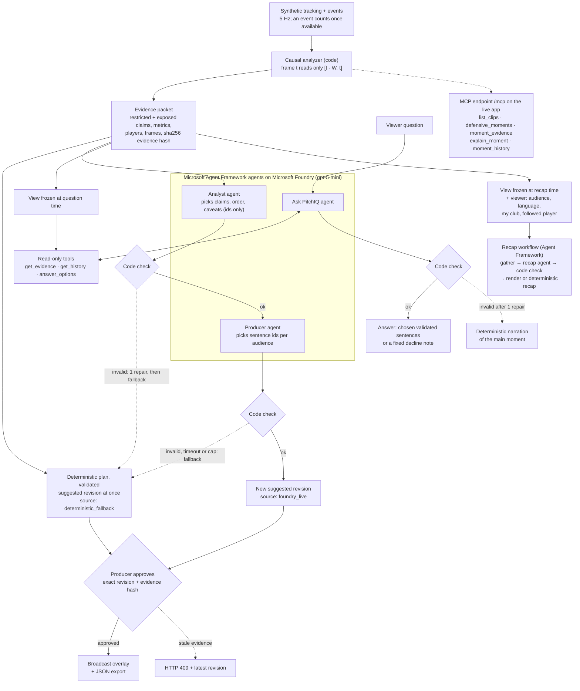

# PitchIQ: Defensive Intelligence

[](https://github.com/kyuhyeokseo/pitchiq/actions/workflows/ci.yml)

**What a defence takes away and leaves open: measured in code, signed off before air.**

Football broadcasters want AI analysis on air, but they cannot put an invented number or motive on screen. PitchIQ is a replay desk for the seconds before a chance. From synthetic tracking of all 22 players, it measures both sides of a defensive trade-off in code, using only the play seen so far:

- what a defence **restricts**, such as short passes that a nearby defender would reach in time;
- what it **exposes**, such as space behind a high line that cover reaches too late.

**Break down the defence**, a guided mode, tells one moment in four steps a fan can follow: who presses the ball and who follows whom, which passes that shuts, what it leaves open, and where the ball actually went. Each step draws only its own marks on the pitch and names the players it is about. Each clip's breakdown tells the one moment a producer picked for it; the desk still lists every moment the analysis found. The desk offers 8 of the 12 generated clips (the other four stay in the data, the tests and the API).

Each moment's evidence is kept as numbered revisions with a sha256 hash; what happens next is added as a new revision and never overwrites an old one. Agents built with Microsoft Agent Framework, calling `gpt-5-mini` on Microsoft Foundry, choose how each moment is told, answer viewer questions and build recaps, in English and Korean. They return only ids and codes, picking among sentences that code has already filled in from the evidence (or a fixed note), and code checks every choice. Nothing reaches the broadcast view or the graphics export until a producer approves that exact revision and its evidence hash.

**Submitted for Best Enterprise Solution:** sign-off on exact evidence, a hashed evidence trail, bounded cost and keyless Azure sign-in are built in code, and most of these controls have named tests ([Enterprise controls](#enterprise-controls-in-code)). Not built yet: login and a producer role (Microsoft Entra ID); in this demo, whoever opens a replay acts as its producer.

**Live demo:** [pitchiq.greenhill-d04ae279.swedencentral.azurecontainerapps.io](https://pitchiq.greenhill-d04ae279.swedencentral.azurecontainerapps.io) (no login; Azure Container Apps with Foundry agents on) · **Video (under 2 min):** _(link added at release)_ · **Try it:** [seven steps](#try-it) · **License:** [MIT](LICENSE)


<sub>A replay moment from `clip_001` (synthetic), captured by the automated browser walkthrough in offline mode. Red United defends the right-hand goal. **Restricted:** all three short passing options of Blue #5, the player on the ball, are screened (dashed pink lanes end in a stop bar; the faint one crossed out is the pass to the full back that Red #9 cuts as he presses, and the yellow ring is the press). **Exposed:** Red's back line stands 50.4 m from its own goal. The nearest outfield defender other than Blue #9's marker would reach #9's position, projected 1 s ahead, 1.6 s after him (cyan hatched area). Nobody is left unmarked here: every Blue outfield player has a Red player within 10 m. In the app, a side panel keeps the two sides apart and adds what happened next as later revisions.</sub>

## At a glance

| | |
|---|---|
| **For** | Broadcast studios. Producers and analysts get on-screen analysis they can defend within seconds; fans get a short version of the same moment. |
| **Agents** | Code measures; agents choose, answer and recap under code checks; a producer signs off. Four Microsoft Agent Framework agents in the app call `gpt-5-mini` on Microsoft Foundry: Analyst and Producer choose which measured claims lead, which caveats apply and which checked sentences each audience gets (the card shows what they changed against the rule-based plan), Ask PitchIQ answers questions with three read-only tools, and Recap runs inside an Agent Framework workflow. A self-built MCP server (Model Context Protocol, an open standard) also serves five read-only match tools at `/mcp`. |
| **Microsoft technology** | Microsoft Foundry (`gpt-5-mini`), Microsoft Agent Framework, Azure Container Apps with a managed identity (Azure Identity), Azure Monitor Application Insights, GitHub Actions and GitHub Container Registry ([details](#microsoft-technology)). |
| **Guardrails in code** | Agents only choose ids, so a prompt-injected question cannot put its own words or numbers on screen (unit-tested, and 6 of 6 live attempts in the Ask check). Code checks every choice and allows one repair, and a deterministic fallback is always ready. A producer approval gate returns HTTP 409 on stale evidence. Time, call, concurrency and daily limits apply. Azure sign-in needs no keys. |
| **Measured live** (2026-10-24) | Analyst → Producer: 8 of 8 runs validated, 4.6–7.7 s, about 0.1–0.2 US cent per run. Ask PitchIQ: typically 5–11 s of agent time (up to 25 s in one run, 34.4 s in the browser), about 0.2–0.5 cent per question. One clip replayed live: about 1 cent. |
| **Evaluated** | A robustness check on 144 perturbed synthetic plays from unseen seeds of the project's own generator; half are look-alike counter-examples built so that no exposure should be claimed. After the generator's team behaviour was made more realistic in three rounds of review as football fans (keepers at home, formation and spacing, goal-distance danger, safer passes, one man each in a man-oriented midfield, pressers standing 3 m off the ball, a zonal back line; generator 0.8.1), a moment of the designed kind was found at the designed time in 143 of 144, a claim that should have been held back was made in 3 of the 72 counter-examples, and 84 of 108 designed exposed claims were found (8 of 12 in the weakest set-up). This checks consistency with the design, not accuracy on real matches. All backend tests pass except 4 recorded expected failures, and all browser checks pass ([counts and dates](#measured-results)). |
| **Data** | Synthetic only. Real tracking (IDSSE, CC BY 4.0) was used offline only, to calibrate the generator and to train an optional movement model that is not the default; it is not served and not in this repository ([what is synthetic](#what-is-synthetic)). |

## Enterprise controls, in code

What a broadcaster gets:
1. **A human signs off.** A producer approves one exact revision together with its evidence hash. Stale evidence returns HTTP 409. The broadcast view and the export serve approved revisions only.
2. **The model cannot invent a number or a motive.** Agents return ids. Code fills every number from the evidence and checks every choice, and the sentence templates describe what was observed, never intent.
3. **Cost and latency are bounded and measured.** Analysis takes 9.4 ms per step (p95, measured on an HPC compute node), and the deterministic plan is on screen at once. Cloud narration arrives later as a new revision (4.6–7.7 s per Analyst → Producer run in smoke runs; in a replay the moments' runs queue, two at a time), for about 1 US cent per replayed clip, under one daily cap.
4. **No keys, and a tested privacy boundary.** Sign-in uses the Azure CLI credential locally and the app's managed identity on Azure (the live demo). Tests keep serving code away from the generator's private truth.
5. **Hand-off to graphics.** An approved moment exports as JSON: the evidence packet plus four overlay snapshots (Fan/Analyst × EN/KO), each tied to its frame.

Most controls have tests, named in the table (all in `backend/tests/`).

| Control | What it does | Where in code | Tests |
|---|---|---|---|
| **Human approval gate** | A producer approves one exact insight revision together with its evidence hash. If newer evidence exists, the API returns 409 with the latest revision. The broadcast view and the JSON export serve approved revisions only and return 409 otherwise. When a newer plan for the same evidence arrives after an approval, broadcast keeps airing the approved revision's own narration until the newer one is approved; rejecting the newer one leaves the approved one on air. An approval counts only while the analysis has that exact revision and evidence hash, so after a seek it can never name a revision nobody approved. The export carries a decision record (insight and episode revision, evidence hash, decision time in UTC, source, trace id). Approval and broadcast visibility are separate states. | `backend/app/replay/session.py` (`ReplaySession.decide`), `backend/app/api/app.py` | `test_v2_narrative_api.py` |
| **Append-only, hashed evidence** | Every episode revision is an immutable `EvidencePacket` with a sha256 hash of its canonical JSON. Outcomes and later responses become new revisions, so nothing rewrites the past. | `backend/app/contracts/evidence.py`, `backend/app/analytics/tradeoffs.py` | `test_v2_contracts.py`, `test_v2_tradeoffs.py` |
| **Agents only choose** | Agents return ids, never prose or numbers. Code binds the ids to the packet and fills in one of 51 bilingual registry templates. For each Foundry revision, the moment card shows what the agents changed against the rule-based plan for the same evidence (claim led with, claims left out or added, caveats, sentences kept, dropped, added and moved), computed in code. | `backend/app/agents/llm_plans.py`, `backend/app/narrative/` | `test_v2_cloud.py`, `test_v2_narrative_api.py` |
| **Code validation, one repair, deterministic fallback** | Validators check ids, templates, audience and language, caveats against the packet's state, and that a complete trade-off keeps both sides. One repair is allowed, with the reason given. If it still fails, the deterministic plan stays, and that plan is always on screen first. | `backend/app/agents/validate.py`, `fallback.py`, `cloud.py` (`run_pipeline`), `ask.py` (`validate_ask`) | `test_v2_cloud.py`, `test_v2_ask.py` |
| **Bounded time, calls and spend** | Narration: 8 s per stage, 20 s per pipeline, at most 3 model calls including the repair, 2 concurrent pipelines, at most 4 pending per replay. Ask: 45 s, at most 2 runs and 8 tool calls per question, at most 6 model round trips per run, one question or recap at a time per replay (429), 2 questions or recaps in flight. One daily cap (`FOUNDRY_DAILY_LIMIT`) is shared by narration runs, Ask questions and recaps; beyond it the deterministic plan, answer or recap is used. | `backend/app/agents/cloud.py` (`Limits`), `ask.py` (`AskLimits`), `gateway.py` | `test_v2_cloud.py`, `test_v2_ask.py` |
| **No stale narration on air** | A late result is recorded in history and never attached to the broadcast view. The cache key combines the evidence hash, the prompt, template and analytics versions, and the model, so old narration never mixes with new evidence. | `backend/app/replay/session.py` (`_attach_cloud`), `backend/app/agents/cloud.py` (`cache_key`) | `test_v2_cloud.py` |
| **Provenance and traces** | Agent runs, model and tool calls and each pipeline, question and recap are traced in Application Insights on the live app (no prompt or model text). Each revision carries a `source_mode` (`foundry_live`, `foundry_cached` or `deterministic_fallback`) and a trace id. A trace records stage times, the deployment name, attempts, validation error codes and the token counts the service reported. It never records prompts or credentials. `/api/health` reports "configured" separately from "last call succeeded". | `backend/app/agents/cloud.py` (`Trace`), `ask.py` (`AskTrace`), `backend/app/api/app.py` | `test_v2_cloud.py`, `test_v2_ask.py`, `test_v2_narrative_api.py` |
| **Sign-in without keys, no secrets in code** | Uses the Azure CLI credential locally and managed identity on Azure. `.env` is gitignored. The container definition ignores `.env` (`PITCHIQ_DOTENV=0`) and runs as a non-root user. | `backend/app/agents/gateway.py`, `.gitignore`, `infra/Dockerfile` | No test. Both ran live on 2026-10-24: the Azure CLI credential in development, and the Container App's system-assigned managed identity (role: Foundry User on the Foundry resource only) on the public demo. |
| **Privacy boundary enforced by tests** | The generator's private truth (recipes, intent, seeds, expected claims) stays out of serving code: a source scan fails the tests if serving code references it. The public clips and the health and catalog payloads are scanned for truth tokens. The image build context is a whitelist that leaves out generator code and truth. | `.dockerignore`, `infra/Dockerfile` | `test_privacy.py` (source scan), `test_v2_generator.py` (public clips), `test_v2_narrative_api.py` (payloads), `test_v2_packaging.py` (image) |
| **Causal by construction** | The analysis at frame t reads only `[t - W, t]`, and an event counts only once it is available. Ask and MCP tools see only revisions up to the asked time. | `backend/app/replay/session.py`, `backend/app/agents/tools.py` (`View`) | `test_v2_tradeoffs.py`, `test_v2_agent_tools.py`, `test_v2_ask.py` |
| **Session isolation and limits** | Each replay has its own token (403 on a wrong one), and a control call for an old epoch gets 409. Approvals belong to one session and one exact revision: another session never sees them, and a newer revision is suggested again. A seek resets broadcast visibility to hidden, but the approval stays valid for the exact revision and evidence hash it named. At most 20 replays are open; a new one closes the least recently used. | `backend/app/api/app.py`, `backend/app/replay/session.py` (`SessionStore`) | `test_v2_narrative_api.py`, `test_v2_sessions.py` |
| **Typed contracts end to end** | Pydantic v2 on the server and zod in the browser validate payloads. Overlay geometry is checked against the players in that frame and the pitch bounds. | `backend/app/contracts/`, `frontend/src/schemas.ts`, `backend/app/overlay/builder.py` (`validate_overlay`) | `test_v2_contracts.py`, `test_v2_families.py` |

**Path to production (not built):**
- A licensed tracking feed in place of the synthetic clips, through the same ingest contracts.
- Microsoft Entra ID sign-in with a producer role (for example through Container Apps authentication), so approval becomes a real permission rather than a per-session preview control.
- A shared session store, so more than one replica can run, and analyser checkpoints so a seek does not rebuild the analysis.
- One suggested moment per possession for a full match, so a producer sees a short list.
- The origin check the design calls for.

## What it does

| Stage | What PitchIQ does today | Where |
|---|---|---|
| **Ingest** | Replays tracking for 22 players and the ball at 5 Hz, with timestamped events, as a stream. An event reaches the analysis only after its `available_at_s` time. Every frame is validated against typed contracts (schema 2.0). | `backend/app/contracts/`, `backend/app/replay/` |
| **Interpret** | Code analyses a trailing window: phase, defensive lines (it abstains when unsure), man-oriented marking, pressure, ground-pass lane access with approximate offside, cover arrival including the goalkeeper, and central player counts. The results become trade-off episodes that keep restricted and exposed claims apart. The attack's response, the defence's adjustment and the outcome are added as new revisions. | `backend/app/analytics/` |
| **Explain** | The Analyst and Producer agents choose which claims to tell, in what order, with which caveats, and which validated sentences each audience gets. Ask PitchIQ answers viewer questions. Code fills in every number from the evidence packet. | `backend/app/agents/`, `backend/app/narrative/` |
| **Render** | SVG overlays on the pitch: screened lanes, exposure zones, cover timing, line height, local player counts and pressure. Each element links to its players, frames and metrics. Also: Before/After views, an episode timeline, a broadcast view with a caption bar, and JSON export of an approved moment. **Break down the defence** walks through one moment in four steps (the press and who follows whom, what it takes away, what it leaves open, what happened, with the ball's path from the frames), each on the revision that first had it (what it takes away and what it leaves open on the same moment when the restriction still holds then), then puts it on air after approval. When the analysis recorded no outcome, the last step shows the next pass or shot the replay saw (received, intercepted or stopped) as an observation, or says that the clip ends first. A press step without a sentence about the press gives the player on the ball and the nearest defender, measured on its frame. The panel switches between the clip's moments. Its sentences are the code-rendered ones; no model writes them. The pitch rings the unmarked players of the team on the ball (no defender within 10 m and none following him; the six with the most room within 60 m of the ball), and the "what it leaves open" step lists them; on air, the sentences name players and movements but no distances (the numbers stay in the analyst view and the pitch labels). It glides between the 5 Hz frames while playing. | `backend/app/overlay/`, `backend/app/replay/breakdown.py`, `frontend/src/` |
| **Personalize** | Fan or Analyst depth, in English or Korean, built from the same evidence (four validated variants per insight). **My club** marks every moment as your club defending or attacking. **Follow a player**: click any player for a ring and their measured speed (a sprint at 7 m/s or more) and filter the timeline to the moments whose evidence names them. Choices stay in the browser. | `frontend/src/App.tsx`, `frontend/src/Pitch.tsx`, `backend/app/narrative/registry.py` |

Who does what:
- **Studio producer:** sees suggested moments while the replay runs, checks the evidence, approves an exact revision for the broadcast view and exports it as JSON.
- **Studio analyst:** clicks any lane, zone or number to see the players, frames and metrics behind it. The Analyst wording includes player numbers, measured values and caveats.
- **Fan app:** short Fan wording in English or Korean. Ask PitchIQ answers questions such as "What did that leave open?"

## How the agents work




*Real Foundry calls on 2026-10-24 (gpt-5-mini): narration written by the Analyst and Producer agents; an Ask answer whose first choice the code check refused (`unknown_option`), so the agent was told why, repaired it and passed; and a Recap built by the workflow. Every step, time and token count shown is from the run. Full page: [`docs/foundry_live/ask_and_narration_live.png`](docs/foundry_live/ask_and_narration_live.png).*

- **Analyst and Producer** (`pitchiq-analyst`, `pitchiq-producer`) are app-owned `agent_framework.Agent`s on `agent_framework.foundry.FoundryChatClient`. They return structured output through a Pydantic `response_format`.
  - Both read the evidence packet and return ids only. The Analyst picks which claims and changes to tell, in what order, and with which caveats. The Producer picks sentence options for the Fan and Analyst audiences, shared by both languages.
  - Code binds those ids to the packet's own metrics and fills in bilingual registry templates, so a model never writes a number.
- **The replay never waits for the cloud.**
  - Each revision gets the deterministic plan at once.
  - A validated cloud plan arrives later as a new suggested revision (`foundry_live`, or `foundry_cached` on a repeat).
  - A result that arrives after a seek, or after the evidence has moved on, goes to the session history. It never reaches the broadcast view.
  - Each episode runs one job at a time, and only its latest revision is sent. Important episodes go first.
- **Ask PitchIQ** (`pitchiq-ask`) answers a viewer's question about the replay so far.
  - Its three tools (`get_evidence`, `get_history`, `answer_options`) read a view frozen at the moment of the question. No tool takes a time, so later play is out of reach.
  - It answers with one moment and 1–5 validated sentences, or declines with a fixed reason (`not_yet_known`, `outside_scope`, `no_moment_yet`).
  - The agent is instructed to mark a question about intent ("Why did the coach...?") with a fixed note, "PitchIQ does not read minds...", and then say what the shape did. Code allows only that note or a fixed decline. In live runs the agent added the note 3 of 3 times after the instruction was made explicit.
  - Offline, or when the agent is off, over its cap or fails, Ask answers with the narration of the main moment and adds no note.
  - Each answer lists its tool calls, times and token counts.
- **Recap** (`pitchiq-recap`) is a Microsoft Agent Framework **workflow** (`backend/app/agents/recap_workflow.py`, graph in [`docs/agents/recap_workflow.mmd`](docs/agents/recap_workflow.mmd)): `gather` (code) → `recap_agent` (Foundry, with the read-only `answer_options` and `get_evidence` tools) → `check` (code) → `render`, or `fallback` to the deterministic recap.
  - The agent picks 1–3 moments of the replay so far and 1–3 validated sentences for each, for one viewer: audience, language, their club and the player they follow.
  - Code tags each moment as "your club defending/attacking" and "involves the followed player", and requires a followed player's moment when one exists.
  - Each recap lists its workflow steps, tool calls, times and token counts.
- **MCP server** (`backend/app/agents/mcp_server.py`) gives any MCP client five read-only tools over stdio or streamable HTTP: `list_clips`, `defensive_moments`, `moment_evidence`, `explain_moment` and `moment_history`. Like Ask, the tools only see analysis up to the requested time. It is mounted at `/mcp` in the web app (stateless streamable HTTP, JSON responses) and is live at `https://pitchiq.greenhill-d04ae279.swedencentral.azurecontainerapps.io/mcp`. Besides localhost, it answers only the host names in `PITCHIQ_PUBLIC_HOSTS`.


## Microsoft technology

| Technology | Role in PitchIQ | Where in code | Verified |
|---|---|---|---|
| **Microsoft Foundry**: model deployment `gpt-5-mini` (Global Standard) | Serves the model calls of all four agents | `backend/app/agents/gateway.py` | Live calls, 2026-10-24 |
| **Microsoft Agent Framework** (`agent-framework-foundry` 1.15.0 with `agent-framework-core` 1.23.0; exact pins in `infra/constraints.txt`) | App-owned `Agent`s on `FoundryChatClient`, structured output, tool calling (Ask, Recap), and a `WorkflowBuilder` workflow with switch-case routing for the Recap | `gateway.py`, `ask.py`, `recap_workflow.py`, `cloud.py` in `backend/app/agents/` | Live calls, 2026-10-24 |
| **Azure Identity** (`azure-identity` 1.26.0) | Sign-in without keys: `AzureCliCredential` locally, `ManagedIdentityCredential` on Azure | `backend/app/agents/gateway.py` | Both ran live, 2026-10-24 (managed identity on the deployed app) |
| **Azure Container Apps** (Consumption, Sweden Central) | Hosts the public demo: one container with the web app, the API, the WebSocket and `/mcp`; one replica; system-assigned managed identity; the Foundry settings and the daily cap as environment variables | `infra/README.md` (the commands used), `infra/Dockerfile` | Deployed 2026-10-24; live agent calls and MCP ran against it |
| **Azure Monitor Application Insights** (`azure-monitor-opentelemetry` 1.8.11) | Traces from the live app: the Agent Framework's agent runs, model and tool calls (token counts, no prompt or model text), the Foundry calls, a PitchIQ span per narration pipeline, question and recap, and API requests except per-frame polling. Off unless the connection string is set | `backend/app/telemetry.py`, `infra/README.md` | Traces from the live app seen on 2026-10-25 (image `sha-f45f1a6`) |
| **GitHub Actions** and **GitHub Container Registry** | CI on every push: tests, frontend build, image build, an offline smoke test and the privacy check inside the image, then the image is pushed to `ghcr.io/kyuhyeokseo/pitchiq` (public) | `.github/workflows/ci.yml` | The first run, 2026-10-24, passed every step |

Also built: an MCP server (Model Context Protocol, an open standard) that exposes the five read-only match tools; mounted at `/mcp` in the web app and live on the demo URL.


## Measured results

| What | Result | Date | How it was measured |
|---|---|---|---|
| Analyst → Producer on Foundry | 8 of 8 plans validated (1 after its single repair). 4.6–7.7 s end to end, 2.3k–4.4k input and 0.2k–0.3k output tokens, about 0.1–0.2 US cent per run. | 2026-10-24 | Live `gpt-5-mini`, reasoning effort `minimal`, 8 runs of the smoke runner (`python -m app.agents.smoke --clip …`) over 7 clips. Times and tokens come from the run trace. Cost is estimated from the reported tokens at $0.25 per 1M input and $2.00 per 1M output tokens; it is not a billing record. Log: [`docs/foundry_live/MEASUREMENTS.md`](docs/foundry_live/MEASUREMENTS.md) |
| Ask PitchIQ on Foundry | Agent time 5.8–16.5 s in 9 smoke runs (16.5 s: an early run that needed its single repair); in 10 questions in the browser 5.0–25.0 s (median about 7 s; one run took 25 s, one needed its single repair). 2–5 tool calls, 6.2k–17.5k input and 132–304 output tokens, about 0.2–0.5 cent per question (the top of each range is the early smoke run that needed its repair). Intent questions (EN, EN, KO) got the fixed note 3 of 3 times after the instruction was made explicit. "Will Blue score?" was declined as not yet known. | 2026-10-24 | Smoke runner with `--ask`, and questions in the real UI with Foundry on (several sessions that evening). Same log |
| Recap workflow on Foundry | 6 of 7 runs validated: 5.0–15.5 s, 2–3 tool calls. In the smoke runs 7.1k–8.0k input and 147–207 output tokens, about 0.2 cent per recap. The other hit a transient service error and showed the deterministic recap, labelled. | 2026-10-24 | 4 smoke runs with `--recap` (EN with my club and a followed player; KO with my club) and 3 in the real UI. Same log |
| Live 1× replay of `clip_001` | 6 of 7 episodes ended with a validated Foundry plan on their final revision. The 7th kept the deterministic plan after a Producer validation failure. 11 pipeline runs, about 1 cent per clip. | 2026-10-24 | App in Foundry mode, one full replay at 1×, per-episode sources and traces. A bug found later made the replay clock run about 1.8× fast while a browser was connected (fixed, with a test), so the agents had less time than at a true 1×. Same log |
| Ask check (24 questions written and published before the run) | The agent answered 21 (3 hit a transient service error and got the labelled fallback); 19 of those 21 met their expectation: routing to the moment asked about 5 of 6, declines 5 of 6, intent questions with the fixed note 4 of 4, prompt-injection attempts 6 of 6 (no injected text or number on screen). Misses: a question about the 10:29 line drop went to the 10:22 moment, and "Will Blue score from this?" asked before the outcome got the moment instead of the "not yet known" decline. The app's no-agent answer meets 10 of 24. 3.7–19.9 s per question, about 5 US cents for the run. | 2026-10-25 | `evaluation/ask_check/` (items sha256 `3dfe2869…`), report in `evaluation/reports/ask_check/ask-check-1/` |
| Robustness check: story matching | 143 of 144 perturbed synthetic plays (unseen seeds and parameter draws) matched their designed story. Designed claim precision 227/234 (0.97). Restricted / exposed recall 0.99 / 0.78. | 2026-10-27 | `make evaluate`, holdout-v2-0.15 (generator 0.8.1, analytics 0.4), deterministic narration. `evaluation/reports/holdout_v2/holdout-v2-0.15/`. Before the team-behaviour changes (holdout-v2-0.6, 2026-10-23): 144 of 144, precision 241/242, recall 1.00 / 0.88. The versions in between (0.7-0.14, other seeds) are in `docs/evaluation.md` |
| Robustness check: counter-examples | Wrong emphasis in 3 of 72 (target 0), all three in the set-up where the wingers support the screen (1 of 72 in holdout-v2-0.6 and 0.11). | 2026-10-27 | Same report |
| Robustness check: abstention | On the 72 plays where exposure was expected, the story stayed partial or unmatched in 11. Exposed-claim recall was lowest in the central screen (16 of 24) and for the free centre-back in the four-player press (8 of 12). | 2026-10-27 | Same report |
| Analysis latency | p50 7.8 ms, p95 9.4 ms per 5 Hz step (target: p95 under 200 ms) | 2026-10-27 | 11,680 frames, single process, CPU on an HPC compute node, during the holdout run |
| Tests | 278 passed, 4 expected failures | 2026-10-27 | `make test`. The 4 are strict expected failures: on the demo seed, since generator 0.8, clip 1 shows no isolated 1v1 and clip 3's dropping ten is not a free receiver (both were 0.4 s claims just before the pass; across unseen seeds they are mostly found) |
| Browser walkthrough | 62 of 62 checks passed, no browser console errors (74 before the clips the desk no longer offers were dropped) | 2026-10-27 | Headless Chromium drives the real UI in offline mode (`make walkthrough`), including the five steps of the guided breakdown (one moment per clip), Pause and seek-bar checks, and three checks over a slow link (400 ms per request, WebSocket frames held back as long). See `docs/walkthrough/report.json` and the screenshots |
| Feature sweep over the 8 clips the desk offers | Each clip's breakdown (one moment, 4 steps), On air, the desk features and playback on each clip: no page errors or failed actions; while playing, players move at most 0.14 m per animation frame | 2026-10-27 | `evaluation/walkthrough/sweep.py` (offline), then a screenshot review; fixes and known limits in [`docs/evaluation.md`](docs/evaluation.md) |
| Deployed app | Managed identity reached Foundry: an Ask answered in 5.9 s with 2 tool calls, a Recap in 8.2 s, both validated; `/mcp` listed its 5 tools over HTTPS; a 1× replay streamed over the WebSocket. | 2026-10-24 | Calls from the development machine to the public URL. Log: [`docs/foundry_live/MEASUREMENTS.md`](docs/foundry_live/MEASUREMENTS.md) |
| Browser walkthrough on the public URL | 70 checks passed, 0 failed, no browser console errors. With Foundry on, 6 results are kept as information: 4 checks of particular template sentences (the agents may choose other validated sentences) and whether the Ask and Recap agents' choices passed the code check (both did in this run; in an earlier run the code check refused both twice, and the deterministic answer and recap were shown with the agent runs in their traces). | 2026-10-27 | The same walkthrough with `--base-url` against the live app (image `sha-82cbd01`). Same log |

All of these are small samples. The live Foundry numbers come from one day: 8 smoke runs at minimal effort (plus 4 at low effort), a handful of questions and one full replay (11 pipelines). They are not a benchmark. Earlier versions and the full evaluation are in [`docs/evaluation.md`](docs/evaluation.md).

## What is synthetic

> **Every clip PitchIQ serves is synthetic.**
> - The 12 clips in `data/public/` come from the project's own simulator. Each clip stages one defensive set-up; around it the defending team keeps its shape: every player stays within a leash of his formation spot (moved with the ball) and apart from team-mates, the back line holds the edge of its box, the nearest man engages a free carrier near goal (goal-distance danger), a bypassed defender gets back goal-side, a screen or press skips a man a team-mate already has, the keeper stays at home, linking passes wait for a likely lane (pass success from distance and defenders near the line), and a clip ends once the defence wins the ball.
> - Teams and players are fictional. No league or club names, logos or crests are used.
> - The generator's private material (recipes, intent, seeds, expected claims) is kept in `evaluation/private_truth/`. Only the offline evaluation reads it. Tests keep serving code away from it, and the image definition leaves it out.
>
> **Real tracking data was used offline only.** The data is the IDSSE dataset (Bassek et al. 2025, CC BY 4.0). It was used for two things:
> - calibrating the generator's off-ball movement statistics;
> - training an optional learned movement model (MotionGNN), which is not the default generator.
>
> Real tracking data is not served, not part of the serving image and not in this repository. Only trained weights and aggregate statistics are included. See [NOTICE](NOTICE).

## Quick start

Run every command from the repository root: the server reads the clips from `data/public/` relative to it (or set `PUBLIC_DATA_DIR`). Development was done on Linux.

### Offline mode (no Azure needed)

With Docker, the image CI built and smoke-tested:

```bash
docker run --rm -p 8000:8000 ghcr.io/kyuhyeokseo/pitchiq:latest   # http://127.0.0.1:8000
```

From source. Requirements: Python 3.12 and Node 20.

```bash
python3.12 -m venv .venv
.venv/bin/pip install -c infra/constraints.txt -e ".[dev,foundry,mcp,telemetry]"   # the exact versions CI installs
(cd frontend && npm ci && npm run build)
.venv/bin/python -m uvicorn app.api.app:app --app-dir backend --port 8000   # http://127.0.0.1:8000
```

The Makefile wraps the same steps: `make setup` creates the virtual environment with `uv` (same pins), `make build` builds the frontend and `make dev` starts the server.

On Windows, WSL 2 is the simplest route. A PowerShell equivalent (not tested):

```powershell
py -3.12 -m venv .venv
.venv\Scripts\pip install -c infra/constraints.txt -e ".[dev,foundry,mcp,telemetry]"
cd frontend; npm ci; npm run build; cd ..
.venv\Scripts\python -m uvicorn app.api.app:app --app-dir backend --port 8000
```

Offline is the default mode (`LLM_MODE=offline`).
- No Azure account and no `.env` file are needed.
- Analysis, overlays, approval, export and Ask all run on the deterministic, validated plans, and the header says so.
- Ask answers every question with the narration of the main moment (no agent, so no intent note).

### With Microsoft Foundry

You need the Azure CLI, a Foundry project with a deployed model (tested with `gpt-5-mini`), and the **Foundry User** role (formerly Azure AI User) for your identity on that project. An Owner role alone does not allow model calls.

```bash
cp .env.example .env
# In .env set:  LLM_MODE=foundry
#               FOUNDRY_PROJECT_ENDPOINT=https://<resource>.services.ai.azure.com/api/projects/<project>
#               FOUNDRY_MODEL=<your deployment name, e.g. gpt-5-mini>
# .env.example already sets FOUNDRY_DAILY_LIMIT=100, FOUNDRY_REASONING_EFFORT=minimal and AUTH_MODE=azure_cli.
az login                 # add --tenant <tenant-id> if the Foundry resource is in another tenant
make foundry-smoke       # one real Analyst -> Producer run on clip_003; prints the trace, exits 1 on fallback
.venv/bin/python -m app.agents.smoke --clip clip_001 --ask "What did that leave open?"
make dev
```

- The project endpoint is on the Foundry project's Overview page.
- `FOUNDRY_REASONING_EFFORT=minimal` leaves margin under the 8 s stage timeout. With `low` effort, runs took 7.3–14.7 s and the Producer stage came close to 8 s.
- `/api/health` reports `foundry_configured` (the settings are present) separately from `last_cloud_result.last_call_succeeded` (a real call worked).
- On Azure, use `AUTH_MODE=managed_identity`. `infra/README.md` has the commands the live demo was deployed with.

### Try it

1. Open the live demo (no login; all data is synthetic). **Clip 1** opens on a question: click **Break down the defence**. Step through the press (yellow; white tethers show who follows whom), what it takes away (pink), what it leaves open (cyan) and what happened (the white arrow is the ball's path), then **On air** to approve the moment and see it on the broadcast view. Click **Explore the desk** to continue.
2. Press **Play** at 1× (at the end of a clip, Play starts it again from the beginning). Pink dashed lanes ending in a stop bar show what the press takes away; the cyan hatched area shows what it leaves open.
3. When the clip ends, the desk replays its main moment. Click a lane, zone or label: the evidence panel shows the players and measurements behind it (**Details** adds frame numbers and ids).
4. In **Ask PitchIQ**, ask "Why did Red set up like that at 10:25?" or click a suggested question. Under the answer, "How the agent answered" (open for the newest answer) lists the tool calls and the code check. Offline, Ask returns the narration of the main moment for any question.
5. When the card says "Written by Microsoft Foundry agents" (this can take several seconds after the clip ends; if the agents' plan fails its code check or the daily cap is reached, the card stays "validated templates", which you can approve too), click **Approve**, then **Export JSON** on the same card, then switch to **Broadcast**. Broadcast hides the side panel; switch back to **Inspector** to continue.
6. Switch between **Fan** and **Analyst**.
7. Choose a club under **Pick your club**, click any player to follow them, then press **Recap so far**.

### Other commands

```bash
make test              # backend test suite
make fixtures          # regenerate data/public/ and evaluation/private_truth/ (deterministic; a test checks the committed files match)
make evaluate          # holdout evaluation -> evaluation/reports/holdout_v2/<version>/
make walkthrough SRUN= # headless-browser walkthrough -> docs/walkthrough/
```

- `make evaluate` overwrites the report of the version named in `evaluation/holdout_v2.yaml`. For a new run, set a new version and new seeds there first.
- `make walkthrough` serves `frontend/dist`, so run `make build` first. It also needs `.venv/bin/playwright install chromium` (add `--with-deps` on a fresh Linux machine for the system libraries). `SRUN` is an optional command prefix, for example to run on a cluster compute node.

## Limitations

- **Synthetic only, not validated on real football.** The generator and the analysis thresholds were developed together. The robustness check shows the system is consistent on its own synthetic set-ups, not that it generalises to real matches.
- **Heuristics, not probabilities.** Lane access, pressure, cover and isolation assume fixed speeds: ball 14 m/s, defender 7 m/s, 0.2 s reaction. We assume these settings favour the defender, so restriction is more likely over-called and exposure under-called; this has not been measured on real data.
  - Body orientation is not observed, so the "cover shadow" (the passing lanes a defender blocks just by where he stands) is approximate.
  - Offside is a geometric approximation.
  - The cover model has no momentum.
  - Scores show heuristic evidence strength, not chance of success.
- **Narrow scope.** 12 short clips (about 11–21 s at 5 Hz) cover six defensive set-ups, each with a counter-example; the desk offers 8 of them. Each clip covers one period and ends once the defence wins the ball. There is no full match, scoreboard or xG; the generator's goal-distance danger is a simple expected-threat-like surface, not a fitted xT model.
- **Weak spots** (robustness check, holdout-v2-0.15):
  - Exposed-claim recall is 0.78 overall, 16 of 24 in the central screen (where the outcome agreed with the design in 7 of 12 plays; 4 of 12 on the 0.14 seeds, 10 of 12 on the 0.13 seeds) and 8 of 12 for the free centre-back in the four-player press. It was 0.88 before the generator's team behaviour was made more realistic: realistic defending makes the staged mistakes smaller.
  - Three counter-examples got the wrong emphasis: a free receiver was claimed where the winger's support was meant to take him away.
  - There are 5.2 episodes per clip-minute outside the designed stories. This is an upper bound on false alarms, because some are real side stories.
  - Results move with the seeds and the tuning: the versions in between (holdout-v2-0.7 to 0.14) matched 128 to 141 of 144.
  - Line grouping can briefly abstain when pressers who have been bypassed drop back.
- **Agents choose; they do not write.** Wording is limited to 51 bilingual templates.
- **Intent notes depend on the model.** Code does not detect intent questions; it only allows the agent's fixed note or a decline.
- **Small live samples.** The Foundry numbers come from one day of runs (see [Measured results](#measured-results)).
- **Demo-grade serving.**
  - Sessions live in memory (one replica, one worker). A restart clears them and resets the daily-cap counter.
  - The live demo runs in Sweden Central on 0.5 vCPU, with a daily cap of 300 Foundry runs; beyond it the deterministic plans and answers are shown, labelled.
  - At most 20 replays are open at once. When another starts, the least recently used one is closed, and its viewer starts a fresh replay (approvals in it are lost). Replays close after 30 minutes without a client action, or after 10 if no connection is open.
  - The approval gate is a preview control within one session, not a broadcast permission system. There is no login or role-based access yet.

## Status (2026-10-25)

| Built and verified | Not done yet |
|---|---|
| Causal analytics, trade-off episodes, overlays, the evidence panel, approval with a decision record, the broadcast view, JSON export | |
| The guided breakdown of a moment (four steps from the evidence, then on air) | |
| Analyst → Producer (what they changed is shown, computed in code), Ask PitchIQ and the Recap workflow, with live Foundry calls | The demo video |
| Fan and Analyst wording in EN and KO; My club and Follow a player | |
| MCP server (stdio and streamable HTTP), mounted at `/mcp` and live on the demo URL | |
| Public deployment on Azure Container Apps with a managed identity; CI with the image on GitHub Container Registry | Uptime probe every 30 minutes (`.github/workflows/probe.yml`): added, not yet confirmed running |
| Robustness check, backend tests, browser walkthrough (offline and against the public URL) | |

## Repository map

| Path | Contents |
|---|---|
| `backend/app/contracts/` | Pydantic v2 data contracts (schema 2.0) and evidence hashing |
| `backend/app/analytics/` | Trailing-window analytics and the trade-off engine. Thresholds are in `analytics_config.yaml` |
| `backend/app/overlay/` | Deterministic overlay builder and validator |
| `backend/app/narrative/` | Bilingual sentence-template registry and renderer |
| `backend/app/agents/` | `gateway.py` (the Agent Framework agents) and `recap_workflow.py` (the Agent Framework workflow), the modules that import the Agent Framework SDK; `cloud.py` (bounded pipeline), `ask.py`, `recap.py`, `validate.py`, `fallback.py`, `tools.py`, `mcp_server.py`, `smoke.py` |
| `backend/app/replay/`, `backend/app/api/` | Replay sessions, REST and WebSocket API |
| `backend/app/simulator/` | Synthetic generators (v2 in `defense/`). Private: never imported by serving code and not in the image |
| `backend/tests/` | Test suite, including the privacy and packaging boundaries |
| `frontend/` | React + TypeScript SVG UI with zod-validated payloads |
| `data/public/` | The 12 synthetic clips: `manifest.json`, `tracking.jsonl`, `events.jsonl` |
| `evaluation/` | Robustness-check (holdout) runner, private truth (offline evaluation only), reports, browser walkthrough |
| `docs/` | [`design.md`](docs/design.md) (design summary), [`evaluation.md`](docs/evaluation.md) (evaluation history), `walkthrough/` (browser walkthrough report and screenshots), `foundry_live/` (live measurement log and screenshot), `images/` (README images), `diagnostics/` (offline review renders of synthetic clips and of the optional movement model) |
| `infra/` | Dockerfile, pinned constraints, and the Azure Container Apps deployment commands |
| `.github/workflows/` | CI workflow (`ci.yml`): tests, frontend build, image build with an offline smoke test and a privacy check, push to GitHub Container Registry. Uptime probe (`probe.yml`): GET-only checks of the public URL every 30 minutes |
| `models/` | Optional MotionGNN movement-model checkpoints from an offline experiment. Not the default generator and not in the image |
| `scripts/` | Build and helper scripts |
| v1 prototype | The off-ball overlap prototype from spec v1, kept for later work: `backend/app/{schemas,ingestion,broadcast}/`, `backend/app/analytics/{patterns,significance,pipeline}.py`, `data/fixtures/`, `docs/analytics.md`, `docs/schemas.md` |
| Internal design notes (not submission material) | `PitchIQ_Defensive_Intelligence_Implementation_Spec_v2.md` (Korean, the design baseline). English summary: [`docs/design.md`](docs/design.md) |

## Credits and license

Developed by Kyuhyeok Seo.

Real tracking data, used offline only: Bassek, M., Rein, R., Weber, H. & Memmert, D. (2025). An integrated dataset of spatiotemporal and event data in elite soccer. *Scientific Data* 12, 195. CC BY 4.0. Open-source dependencies are listed in `pyproject.toml`, `infra/constraints.txt` and `frontend/package.json`. See [NOTICE](NOTICE).

Licensed under the [MIT License](LICENSE).
